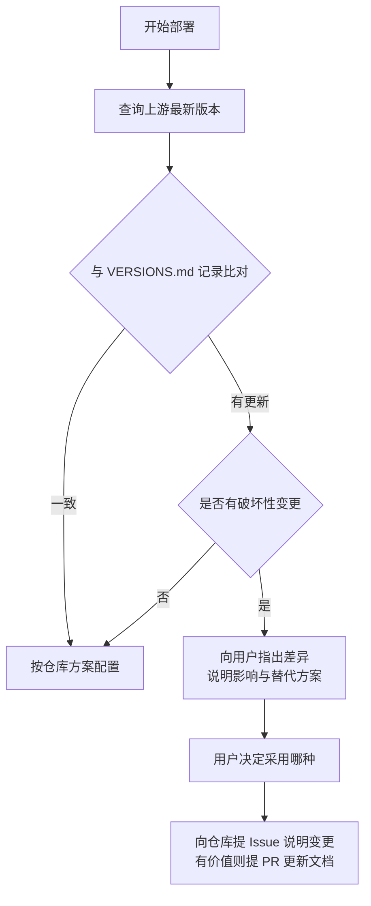

# AGENTS instructions

本文件面向 **AI Agent / 编码助手**。人类用户请看 [`README.md`](./README.md) 与 [`docs/`](./docs/)。

本仓库是**部署方案仓库**，不是可执行程序仓库。Agent 的工作是：按本仓库规范在目标 VPS 上部署、验证、排障，并在上游版本发生破坏性变更时向本仓库反馈。

---

## 1. 项目概览

一套可复用的个人代理部署方案。核心架构：

```text
客户端 mihomo 内核  ──Hysteria2(UDP 443)──▶  VPS: hysteria 服务端
                    ──VLESS+XHTTP(TCP 443)──▶  VPS: Xray 服务端
```

**设计意图**：主入口走 UDP 保证弱网性能，备线走 TCP+CDN 保证 IP 被封锁时仍有通路。两条路径独立，任一失效不影响另一条。

---

## 2. 环境要求

| 项 | 最低要求 | 说明 |
|---|---|---|
| 服务端系统 | Debian 11 / Ubuntu 20.04 | 其他发行版需自行调整包管理命令 |
| 服务端权限 | root | 需要绑定 443 端口、写 systemd unit |
| 客户端 | Clash Verge Rev ≥ 2.0 | 或任何 mihomo 内核客户端 |
| Python（可选） | 3.9+ | 仅 `scripts/` 使用 |

---

## 3. 常用命令

### 客户端 · Clash Verge REST API

前置：**设置 → 外部控制 → 开启**，记下监听地址与密钥。

```bash
API="http://{{CLASH_API_HOST}}:9097"
KEY="{{CLASH_API_KEY}}"

curl -H "Authorization: Bearer $KEY" "$API/version"
curl -H "Authorization: Bearer $KEY" "$API/configs"
curl -H "Authorization: Bearer $KEY" "$API/proxies"
curl -H "Authorization: Bearer $KEY" "$API/rules"
curl -H "Authorization: Bearer $KEY" "$API/connections"

# 切换分组内的节点（节点名含 emoji/中文时必须 URL 编码）
curl -X PUT -H "Authorization: Bearer $KEY" -H "Content-Type: application/json" \
     -d '{"name":"节点名"}' "$API/proxies/分组名"

# 延迟测试
curl -H "Authorization: Bearer $KEY" \
     "$API/proxies/节点名/delay?timeout=5000&url=http%3A%2F%2Fwww.gstatic.com%2Fgenerate_204"
```

成功判据：`PUT /proxies` 返回 **HTTP 204**；`/delay` 返回 `{"delay":<ms>}`。

### 服务端 · 常用检查

```bash
systemctl status xray hysteria-server --no-pager
ss -tulnp | grep -E ':(443|{{SSH_PORT}})'
journalctl -u xray -n 50 --no-pager
xray version
```

### 验证连通性

```bash
# 只读验证（不改任何东西）
bash scripts/verify.sh --host {{VPS_IP}} --port 443
```

---

## 4. 仓库结构

```text
.
├── README.md                 # 人类入口
├── AGENTS.md                 # ← 本文件：Agent 入口
├── VERSIONS.md               # 版本基线
├── docs/
│   ├── best-practices.md     # 完整部署流程
│   ├── troubleshooting.md    # 排障决策树
│   └── warp-outbound.md      # WARP 出口
├── examples/
│   ├── server-xray.jsonc     # 服务端示例
│   └── client-mihomo.yaml    # 客户端示例
└── scripts/
    └── verify.sh             # A 层：只读验证
```

---

## 5. 架构边界

### 可以做

- 按 `docs/best-practices.md` 在目标 VPS 部署协议
- 修改 `profiles/*.yaml` 增删节点、调整规则
- 通过 REST API 切换节点、测延迟、查状态
- 提交 PR 修正文档错误、补充新协议

### 不要做

- **不要**把真实 IP / 域名 / UUID / 私钥写进任何提交
- **不要**在未经用户确认时执行 `systemctl restart` 或改防火墙规则（可能锁死 SSH）
- **不要**跨内核复制配置——字段名不同，会静默失效
- **不要**假设 `curl` 能连通就代表协议可用

---

## 6. 安全模型

### 占位符规则

所有敏感值用双花括号：`{{VPS_IP}}`、`{{UUID}}`、`{{HY2_PASSWORD}}` 等。

**不变量**：渲染或替换完成后，产物中**不允许残留任何 `{{`**。Agent 应自行检查：

```bash
grep -rn '{{' out/ && echo "FAIL: 有未替换的占位符" && exit 1
```

### 真实值存放

```text
local/                    # 已在 .gitignore，绝不提交
├── nodes.local.yaml
└── secrets.local.yaml
```

### 提交前自检

```bash
# 扫描常见敏感特征
grep -rEn '([0-9]{1,3}\.){3}[0-9]{1,3}|[0-9a-f]{8}-[0-9a-f]{4}-[0-9a-f]{4}-[0-9a-f]{4}-[0-9a-f]{12}|PRIVATE KEY' \
  --include='*.md' --include='*.yaml' --include='*.json' . \
  | grep -v '{{' | grep -v '0.0.0.0' | grep -v '127.0.0.1'
```

命中即需人工确认。

---

## 7. 验证清单

任何部署或配置变更后，**按顺序**执行：

- [ ] `systemctl is-active xray hysteria-server` 均为 `active`
- [ ] `ss -tulnp` 能看到预期端口
- [ ] 服务端本机自连可通过（排除客户端因素）
- [ ] 客户端通过该节点能访问外网
- [ ] `GET /proxies` 能看到该节点且类型正确
- [ ] `GET /proxies/{name}/delay` 返回合理延迟
- [ ] 若改过路由规则，确认 `GET /rules` 已生效
- [ ] **确认测试时本地未开启 TUN**（否则结果无效，见第 9 节）

---

## 8. 版本漂移处理流程

代理生态迭代快，Agent 在部署前**必须先查上游最新版本**。



### 查询端点

```bash
# 稳定版
gh api repos/XTLS/Xray-core/releases/latest --jq '.tag_name'
gh api repos/SagerNet/sing-box/releases/latest --jq '.tag_name'
gh api repos/MetaCubeX/mihomo/releases/latest --jq '.tag_name'
gh api repos/2dust/v2rayN/releases/latest --jq '.tag_name'

# Atom feed（含预发布，注意区分 alpha）
curl -s https://github.com/XTLS/Xray-core/releases.atom | grep -o '<title>[^<]*</title>'
```

### 判断「破坏性变更」的标准

出现以下任一情况即视为破坏性变更：

- 配置字段被**移除**（如 Xray 移除 `allowInsecure`）
- 配置字段**改名**且旧名不再兼容
- 协议默认行为改变（如默认开启/关闭某项）
- 最低系统要求提高

### 已知的破坏性变更记录

| 时间 | 组件 | 变更 | 影响 |
|---|---|---|---|
| 2026-10 | Xray v26.10.31 | 默认关闭 MPTCP | 安全修复，建议升级 |
| — | Xray | 移除 `allowInsecure` | 改用 `pinnedPeerCertSha256` |
| — | sing-box | 移除 `insecure` 相关旧字段 | 改用 `tls.insecure` |

---

## 9. 禁止事项与高频陷阱

### 🔴 TUN 模式会让所有直连测试失效

客户端开启 TUN 后接管全部流量，此时对任意 IP 的「直连测试」实际都走了代理，会得到 **1ms 延迟、1 跳直达**的假象。

**判断方法：**

```powershell
Get-NetRoute -DestinationPrefix '0.0.0.0/0' | Sort-Object RouteMetric
Find-NetRoute -RemoteIPAddress {{VPS_IP}}
```

若 `InterfaceAlias` 显示 `singbox_tun` / `clash_tun` / `Mihomo`，测试结果**无效**。

**正确方法**：在服务端抓包，观察 SYN 与 SYN-ACK：

```bash
tcpdump -n -i any "host {{CLIENT_IP}} and tcp port 443" -c 20 -v
```

| 抓包现象 | 结论 |
|---|---|
| SYN 未到达 | 去程阻断，或端口被选择性过滤 |
| SYN 到达、无 SYN-ACK | 服务端未监听或被本机防火墙拦截 |
| SYN 到达、SYN-ACK 已发出、客户端仍超时 | 回程阻断（须先排除 TUN 干扰） |

### 🔴 配置不能跨内核复制

同一功能在不同内核字段名不同，照抄会失败：

| 功能 | Xray | mihomo / sing-box |
|---|---|---|
| 跳过证书校验 | `pinnedPeerCertSha256`（字符串）| `insecure: true` / `tls.insecure` |
| 传输层名 | `network: "xhttp"` | `network: xhttp` |
| XHTTP 参数块 | `xhttpSettings` | `xhttp-opts` |

### 🔴 进程未重启会导致配置漂移

磁盘上的配置已改，但进程仍运行旧配置（内存中）。表现：本机自连成功，外部连接全部失败。

```bash
systemctl restart xray && journalctl -u xray -n 20 --no-pager
```

### 🔴 REALITY 不要换非 443 端口

Xray 启动时会主动警告：

> `REALITY: Listening on non-443 ports may get your IP blocked by the GFW`

换端口不能规避封锁，反而可能加速 IP 被封。

### 🔴 GUI 客户端配置可能存于数据库

部分 GUI（如 v2rayN）配置存 SQLite，修改前必须完全退出程序，否则写入会被覆盖。优先选配置为纯文本 YAML 的客户端。

---

## 10. 参考资料

- Xray-core — <https://github.com/XTLS/Xray-core>
- XHTTP 详解 — <https://github.com/XTLS/Xray-core/discussions/4113>
- REALITY 文档 — <https://xtls.github.io/config/transports/reality.html>
- sing-box — <https://github.com/SagerNet/sing-box>
- mihomo — <https://github.com/MetaCubeX/mihomo>
- mihomo 文档 — <https://wiki.metacubex.one>
- Clash Verge Rev — <https://github.com/clash-verge-rev/clash-verge-rev>
- AGENTS.md 规范 — <https://agents.md>
