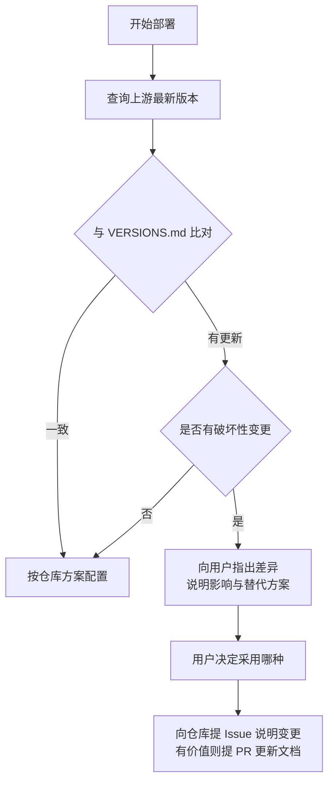

# AGENTS instructions

本文件面向 **AI Agent / 编码助手**。面向人类的内容全部在 [`README.md`](./README.md)。

本仓库是**部署方案仓库**，不是可执行程序仓库。Agent 的工作是：按本仓库规范在目标 VPS 上部署、验证、排障，并在上游版本发生破坏性变更时向本仓库反馈。

---

## 1. 项目概览

个人代理部署方案。核心架构：

```text
客户端 mihomo 内核  ──VLESS+REALITY+Vision(TCP 443)──▶  VPS: Xray 服务端  （主入口）
                    ──Hysteria2(UDP)────────────────▶  VPS: hysteria 服务端（备线）
                    ──VLESS+XHTTP(TCP,过 CDN)────────▶  VPS: Xray 服务端  （IP被封时）
```

**设计意图**：REALITY 直连保证伪装性与性能，Hysteria2 保证弱网表现，XHTTP 提供过 CDN 的最后手段。三条路径独立。

---

## 2. 环境要求

| 项 | 最低要求 | 说明 |
|---|---|---|
| 服务端系统 | Debian 11 / Ubuntu 20.04 | 其他发行版需调整包管理命令 |
| 服务端权限 | root | 绑定 443 端口、写 systemd unit |
| 客户端 | Clash Verge Rev ≥ 2.0 | 或任何 mihomo 内核客户端 |
| 域名 | 仅 XHTTP 过 CDN 时需要 | REALITY / Hysteria2 不需要 |

---

## 3. 常用命令

### 客户端 · Clash Verge REST API

前置：**设置 → 外部控制 → 开启**，记下监听地址与密钥。

```bash
API="http://{{CLASH_API_HOST}}:9097"
KEY="{{CLASH_API_KEY}}"

curl -H "Authorization: Bearer $KEY" "$API/version"
curl -H "Authorization: Bearer $KEY" "$API/configs"
curl -H "Authorization: Bearer $KEY" "$API/proxies"
curl -H "Authorization: Bearer $KEY" "$API/rules"
curl -H "Authorization: Bearer $KEY" "$API/connections"

# 切换分组内节点（节点名含 emoji/中文时必须 URL 编码）
curl -X PUT -H "Authorization: Bearer $KEY" -H "Content-Type: application/json" \
     -d '{"name":"节点名"}' "$API/proxies/分组名"

# 延迟测试
curl -H "Authorization: Bearer $KEY" \
     "$API/proxies/节点名/delay?timeout=5000&url=http%3A%2F%2Fwww.gstatic.com%2Fgenerate_204"
```

成功判据：`PUT /proxies` 返回 **HTTP 204**；`/delay` 返回 `{"delay":<ms>}`。

### 服务端 · 检查

```bash
systemctl status xray hysteria-server --no-pager
ss -tulnp | grep -E ':(443|{{SSH_PORT}})'
journalctl -u xray -n 50 --no-pager
xray version
```

### 密钥生成

```bash
xray x25519     # REALITY 密钥对：PrivateKey 给服务端，PublicKey 给客户端
xray uuid       # 生成 UUID
```

---

## 4. 仓库结构

```text
.
├── README.md              # 面向人类的全部内容（部署、排障、选型）
├── AGENTS.md              # ← 本文件：Agent 入口
├── VERSIONS.md            # 版本基线与破坏性变更记录
├── examples/
│   ├── server-xray.jsonc  # 服务端完整示例
│   ├── client-mihomo.yaml # 客户端完整示例
│   └── warp-outbound.md   # WARP 出口配置
└── .gitignore
```

**人类内容不分散在 docs/**——全部在 README。Agent 需要细节时读 README 对应章节。

---

## 5. 架构边界

### 可以做

- 按 README 在目标 VPS 部署协议
- 修改客户端 `profiles/*.yaml` 增删节点、调整规则
- 通过 REST API 切换节点、测延迟、查状态
- 提交 PR 修正文档错误、补充新协议

### 不要做

- **不要**把真实 IP / 域名 / UUID / 私钥写进任何提交
- **不要**在未经用户确认时执行 `systemctl restart` 或改防火墙规则（可能锁死 SSH）
- **不要**跨内核复制配置——字段名不同，会静默失效
- **不要**假设 `curl` 能连通就代表协议可用

---

## 6. 安全模型

### 占位符规则

所有敏感值用双花括号：`{{VPS_IP}}`、`{{UUID}}`、`{{HY2_PASSWORD}}` 等。

**不变量**：渲染完成后，产物中**不允许残留任何 `{{`**。

```bash
grep -rn '{{' out/ && echo "FAIL: 有未替换的占位符" && exit 1
```

### 真实值存放

```text
local/                    # 已在 .gitignore，绝不提交
├── nodes.local.yaml
└── secrets.local.yaml
```

### 提交前自检

```bash
grep -rEn '([0-9]{1,3}\.){3}[0-9]{1,3}|[0-9a-f]{8}-[0-9a-f]{4}-[0-9a-f]{4}-[0-9a-f]{4}-[0-9a-f]{12}|PRIVATE KEY' \
  --include='*.md' --include='*.yaml' --include='*.json' --include='*.jsonc' . \
  | grep -v '{{' | grep -v '0.0.0.0' | grep -v '{{LOCALHOST}}' \
  | grep -v '127\.0\.0\.0' | grep -v '192\.168' | grep -v '10\.0\.0\.0' | grep -v '172\.16'
```

命中即需人工确认。

---

## 7. 验证清单

任何部署或配置变更后**按顺序**执行：

- [ ] `systemctl is-active xray hysteria-server` 均为 `active`
- [ ] `ss -tulnp` 能看到预期端口
- [ ] 服务端本机自连可通过（排除客户端因素）
- [ ] 客户端通过该节点能访问外网
- [ ] `GET /proxies` 能看到该节点且类型正确
- [ ] `GET /proxies/{name}/delay` 返回合理延迟
- [ ] 若改过路由规则，确认 `GET /rules` 已生效
- [ ] **确认测试时本地未开启 TUN**（否则结果无效）

---

## 8. 版本漂移处理流程

Agent 在部署前**必须先查上游最新版本**。



### 查询端点

```bash
gh api repos/XTLS/Xray-core/releases/latest --jq '.tag_name'
gh api repos/SagerNet/sing-box/releases/latest --jq '.tag_name'
gh api repos/MetaCubeX/mihomo/releases/latest --jq '.tag_name'
gh api repos/2dust/v2rayN/releases/latest --jq '.tag_name'
gh api repos/clash-verge-rev/clash-verge-rev/releases/latest --jq '.tag_name'

# Atom feed（含预发布，注意区分 alpha）
curl -s https://github.com/XTLS/Xray-core/releases.atom | grep -o '<title>[^<]*</title>'
```

### 判据

出现以下任一情况即视为破坏性变更：

- 配置字段被**移除**（如 Xray 移除 `allowInsecure`）
- 配置字段**改名**且旧名不再兼容
- 协议默认行为改变
- 最低系统要求提高

---

## 9. 高频陷阱（Agent 必读）

### 🔴 裸 VLESS（无 Flow）已被弃用

Xray 会输出警告：

```text
The feature VLESS (with no Flow, etc.) is deprecated, not recommended for using
and might be removed. Please migrate to VLESS with Flow & Seed as soon as possible.
```

**REALITY 场景**：必须写 `"flow": "xtls-rprx-vision"`，客户端同步配置 `flow: xtls-rprx-vision`。

**XHTTP 场景**：不能用 Vision flow，`flow` 留空；但仍建议启用 VLESS Encryption。

### 🔴 TUN 模式会让所有直连测试失效

客户端开启 TUN 后接管全部流量，此时对任意 IP 的「直连测试」实际都走了代理，会得到 **1ms 延迟、1 跳直达**的假象。

```powershell
Get-NetRoute -DestinationPrefix '0.0.0.0/0' | Sort-Object RouteMetric
Find-NetRoute -RemoteIPAddress {{VPS_IP}}
```

```bash
ip route get {{VPS_IP}}
```

若 `InterfaceAlias` 是 `singbox_tun` / `clash_tun` / `Mihomo`，测试结果**无效**。

**正确方法**：服务端抓包。

```bash
tcpdump -n -i any "host {{CLIENT_IP}} and tcp port 443" -c 20 -v
```

| 现象 | 结论 |
|---|---|
| SYN 未到达 | 去程阻断，或端口被选择性过滤 |
| SYN 到达、无 SYN-ACK | 服务端未监听或被本机防火墙拦截 |
| SYN 到达、SYN-ACK 已发出、客户端仍超时 | 回程阻断（须先排除 TUN 干扰） |

### 🔴 配置不能跨内核复制

| 功能 | Xray | mihomo / sing-box |
|---|---|---|
| 跳过证书校验 | `pinnedPeerCertSha256`（字符串） | `skip-cert-verify: true` / `tls.insecure` |
| 传输层名 | `network: "xhttp"` | `network: xhttp` |
| XHTTP 参数块 | `xhttpSettings` | `xhttp-opts` |
| Flow 字段 | `settings.clients[].flow` | `flow: xtls-rprx-vision` |

### 🔴 进程未重启导致配置漂移

磁盘配置已改，进程仍运行旧配置。表现：本机自连成功，外部连接全部失败。

```bash
systemctl restart xray && journalctl -u xray -n 20 --no-pager
```

### 🔴 REALITY 不要换非 443 端口

Xray 启动时会警告：

> `REALITY: Listening on non-443 ports may get your IP blocked by the GFW`

### 🔴 XHTTP 的 CDN 相关坑

| 问题 | 解决 |
|---|---|
| 连不上 CF | 面板启用 gRPC 支持 |
| 无法穿透 Nginx | `proxy_pass` 改 `grpc_pass` |
| 长连接被掐断 | CF 会断下行 100 秒无数据的 HTTP，应用层需保活 |
| 页面加载极慢 | 部分客户端 `auto` 不生效，手写 `h2+stream-up` 或 `h3+packet-up` |

### 🔴 GUI 客户端配置可能存于数据库

v2rayN 配置存 `guiNDB.db`（SQLite），修改前必须完全退出程序。优先选 YAML 配置的客户端。

---

## 10. 参考资料

- Xray-core — <https://github.com/XTLS/Xray-core>
- REALITY 文档 — <https://xtls.github.io/config/transports/reality.html>
- Xray 官方示例 — <https://github.com/XTLS/Xray-examples>
- XHTTP 详解 — <https://github.com/XTLS/Xray-core/discussions/4113>
- XHTTP 五合一配置 — <https://github.com/XTLS/Xray-core/discussions/4118>
- VLESS Flow 迁移 — <https://github.com/XTLS/Xray-core/discussions/5568>
- Hysteria2 — <https://v2.hysteria.network/>
- sing-box — <https://github.com/SagerNet/sing-box>
- mihomo — <https://github.com/MetaCubeX/mihomo>
- Clash Verge Rev — <https://github.com/clash-verge-rev/clash-verge-rev>
- AGENTS.md 规范 — <https://agents.md>