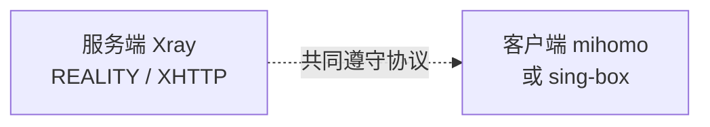
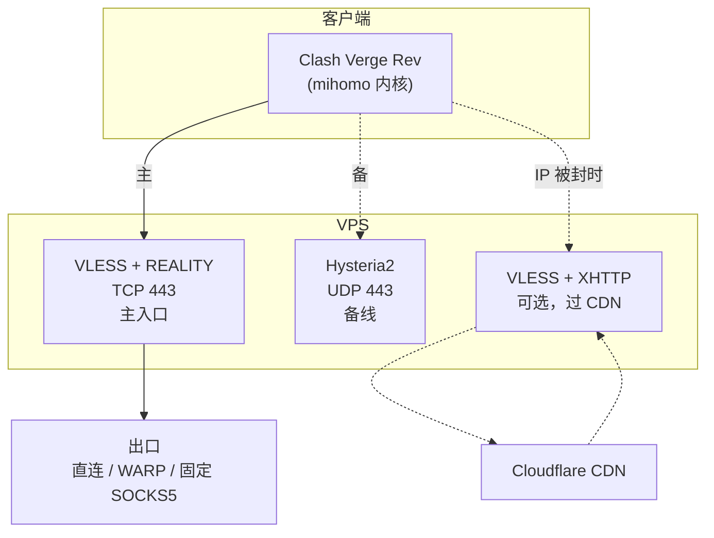
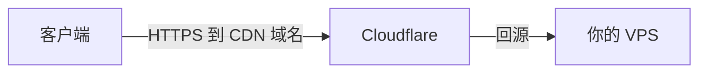
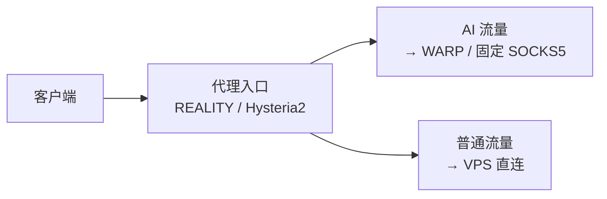
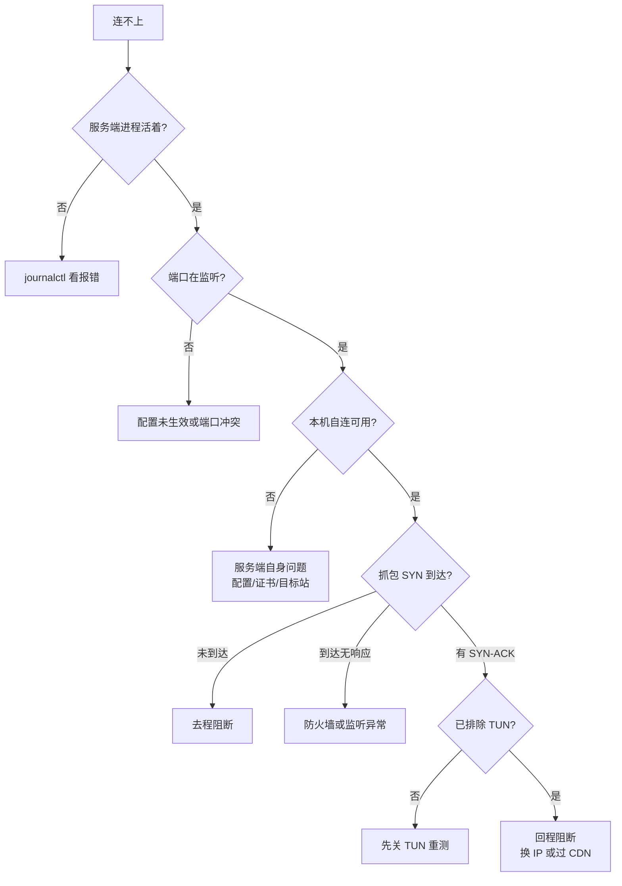

# Personal-Proxy

> 个人代理部署最佳实践。**面向人类的所有内容都在本文档**，AI Agent 规范见 [`AGENTS.md`](./AGENTS.md)。
>
> 仓库内不含任何真实节点、IP、域名或密钥，全部使用 `{{PLACEHOLDER}}` 占位，替换后即可使用。

---

## 目录

- [先说结论](#先说结论)
- [协议选型](#协议选型)
- [内核与客户端](#内核与客户端)
- [架构](#架构)
- [前置：SSH 安全登录](#前置ssh-安全登录)
- [部署：Hysteria2 主入口](#部署hysteria2-主入口)
- [部署：VLESS + REALITY（TCP 主入口）](#部署vless--realitytcp-主入口)
- [部署：VLESS + XHTTP（过 CDN）](#部署vless--xhttp过-cdn)
- [客户端配置](#客户端配置)
- [分流：AI 服务走独立出口](#分流ai-服务走独立出口)
- [验证方法](#验证方法)
- [排障决策树](#排障决策树)
- [反模式清单](#反模式清单)
- [版本与安全](#版本与安全)
- [参考资料](#参考资料)

---

## 先说结论

### 2026 年社区共识：没有单一最优，按网络环境选

| 你的网络环境 | 推荐 | 原因 |
|---|---|---|
| **普通境外 VPS，无特殊封锁** | **VLESS + REALITY + Vision** | 伪装性最好，无需域名和证书，直连性能优秀 |
| **UDP 通畅、TCP 受限** | **Hysteria2** | QUIC 抢带宽强，弱网表现最好 |
| **IP 被针对封锁 / 需要过 CDN** | **VLESS + XHTTP** | 唯一能藏在 CDN 后面的方案 |
| **企业网 / 校园网 / 严格防火墙** | **VLESS + REALITY** | 不熟悉 UDP 常被整体封禁，TCP 443 伪装最稳 |
| **移动网络 / 丢包严重** | **Hysteria2** | Brutal 拥塞控制抗丢包 |

**最通用的生产组合**（社区主流做法）：

```text
主入口：VLESS + REALITY + Vision    （TCP 443，无需域名，伪装性最好）
备线：  Hysteria2                    （UDP，弱网时切换）
可选：  VLESS + XHTTP                （IP 被封时过 CDN）
```

### 关键认知

> **REALITY 仍是 2026 年 TLS 类反审查的事实标准。** Xray 是 REALITY 和 XTLS Vision 的发源地，改动最早落地在这里。XHTTP 是「传输层」而非「协议」，它的核心价值是**能过 CDN**，而不是取代 REALITY。

很多人误以为 XHTTP 是 REALITY 的继任者——**不是**。二者解决不同问题：

- **REALITY** 解决「直连时如何不被识别」
- **XHTTP** 解决「不能直连时如何借道 CDN」

如果 IP 没被封、也不需要 CDN，REALITY 直连依然是最佳选择。

---

## 协议选型

### 三种主流方案对比

| | **VLESS + REALITY + Vision** | **Hysteria2** | **VLESS + XHTTP** |
|---|---|---|---|
| 传输层 | TCP 443 | UDP / QUIC | TCP，可过 CDN |
| 伪装方式 | 复用真实站点的 TLS 握手 | TLS + 混淆（salamander） | 伪装成普通 HTTP |
| 需要域名 | ❌ 不需要 | ❌ 自签即可 | ✅ 过 CDN 时必需 |
| 需要证书 | ❌ 不需要 | 自签可用 | ✅ 过 CDN 需真证书 |
| 抗主动探测 | ⭐⭐⭐ 最强 | ⭐⭐ | ⭐⭐ |
| 弱网性能 | ⭐⭐ | ⭐⭐⭐ 最强 | ⭐⭐ |
| 过 CDN | ❌ 不能 | ❌ 不能 | ⭐⭐⭐ 唯一支持 |
| 首次连接速度 | 较慢（多一次握手） | 快 | 中等 |
| 防火墙友好度 | ⭐⭐⭐ TCP 443 几乎都放行 | ⭐ 严格网络常封 UDP | ⭐⭐⭐ |

### 已不推荐

| 方案 | 状态 |
|---|---|
| VLESS 无 Flow（裸 VLESS） | ⚠️ Xray 已警告弃用，建议迁到带 Flow 的配置 |
| VMess | 老协议，特征明显 |
| Shadowsocks（原版） | 特征易识别，用 SS-2022 替代 |
| Trojan | 需真证书，无额外优势 |
| TUIC | 与 Hysteria2 同类但生态更小 |

---

## 内核与客户端

### 内核分工

| 位置 | 推荐内核 | 理由 |
|---|---|---|
| **服务端** | **Xray-core** | REALITY / Vision / XHTTP 的发源地，实现最完整 |
| **客户端** | **mihomo** 或 **sing-box** | 协议覆盖广，配置透明 |

**服务端和客户端不必使用同一个内核。** 协议是双方共同遵守的约定，只要两端都实现同一协议即可互通。



### 内核能力对比

| 能力 | Xray-core | mihomo | sing-box |
|---|---|---|---|
| REALITY | ✅ 发源 | ✅ | ✅ |
| XHTTP | ✅ 唯一完整 | ✅ | ✅ |
| Hysteria2 | ❌ | ✅ | ✅ |
| TUIC | ❌ | ✅ | ✅ |
| 规则分流 | 🥉 基础 | 🥇 最强 | 🥈 强 |
| REST API | 🥉 基础 | 🥇 完整 | 🥈 双套 |
| 配置稳定性 | 🥈 中 | 🥇 好 | 🥉 变动快 |

**要点**：

- **Hysteria2 不是 Xray 协议**，Xray 内核跑不了
- **REALITY 和 XHTTP 是 Xray 的主场**
- 因此「Xray 服务端 + mihomo 客户端」是最常见的组合

### GUI 客户端

| GUI | Stars | 底层内核 | 配置存储 | 适合 |
|---|---|---|---|---|
| **Clash Verge Rev** | 155k | mihomo | **YAML（透明）** | 默认推荐 |
| **v2rayN** | 120k | Xray / sing-box / mihomo | SQLite（不透明） | Windows 需要 Xray 内核时 |
| **FlClash** | 60k | mihomo | YAML | 轻量跨平台 |
| **Karing** | 16k | sing-box | 文件 | 移动端 |

> ⚠️ **原版 Clash 已停止维护**（`Dreamacro/clash`、`Fndroid/clash_for_windows_pkg` 仓库均已删除）。现在说「Clash」实指 **mihomo**（原 Clash.Meta）。照着旧教程会找不到软件。

**选择逻辑**：如果不需要 Xray 独有能力，优先 Clash Verge Rev——配置是纯 YAML，人和 Agent 都能直接读写。

---

## 架构



**两种入口解决不同问题**：

- REALITY 直连 — IP 干净时优先级最高
- Hysteria2 — UDP 通畅时性能最好
- XHTTP + CDN — IP 被封时的最后手段

---

## 前置：SSH 安全登录

**先确保密钥登录可用，再动任何网络配置**，否则可能把自己锁在门外。

```bash
# 本地生成密钥（已有可跳过）
ssh-keygen -t ed25519 -C "proxy-vps"

# 推送到服务器
ssh-copy-id -i ~/.ssh/id_ed25519.pub root@{{VPS_IP}}
```

本地 `~/.ssh/config`：

```sshconfig
Host {{NODE_NAME}}
    HostName {{VPS_IP}}
    User root
    Port {{SSH_PORT}}
    IdentityFile ~/.ssh/id_ed25519
    IdentitiesOnly yes
```

验证**无密码**登录成功后，再考虑禁用密码认证：

```bash
sed -i 's/^#\?PasswordAuthentication.*/PasswordAuthentication no/' /etc/ssh/sshd_config
systemctl restart ssh
```

> ⚠️ 改 `sshd_config` 前先开第二个终端确认密钥能登录。

**强烈建议把 SSH 改到非标准端口**，尤其当代理端口可能被针对性封锁时——否则代理和 SSH 一起挂掉就彻底失联。

---

## 部署：Hysteria2 主入口

### 安装

```bash
bash <(curl -fsSL https://get.hy2.sh/)
```

### 生成自签证书

```bash
mkdir -p /etc/hysteria
openssl req -x509 -nodes -newkey ec -pkeyopt ec_paramgen_curve:prime256v1 \
  -keyout /etc/hysteria/key.pem -out /etc/hysteria/cert.pem \
  -subj "/CN={{SERVER_NAME}}" -days 3650
chmod 600 /etc/hysteria/key.pem
chown -R hysteria:hysteria /etc/hysteria
```

> **自签证书完全可用**，客户端跳过校验即可。不需要专门申请 Let's Encrypt。

### 配置

`/etc/hysteria/config.yaml`：

```yaml
listen: :{{HY2_PORT}}

tls:
  cert: /etc/hysteria/cert.pem
  key: /etc/hysteria/key.pem

auth:
  type: password
  password: {{HY2_PASSWORD}}

obfs:
  type: salamander
  salamander:
    password: {{HY2_OBFS_PASSWORD}}

masquerade:
  type: proxy
  proxy:
    url: https://www.bing.com
    rewriteHost: true
```

### 启动

官方脚本会创建 systemd unit：

```bash
systemctl enable --now hysteria-server
systemctl is-active hysteria-server
ss -ulnp | grep :{{HY2_PORT}}
```

若无 unit（手动装的二进制），自行创建 `/etc/systemd/system/hysteria-server.service`：

```ini
[Unit]
Description=Hysteria Server
After=network.target

[Service]
Type=simple
ExecStart=/usr/local/bin/hysteria server --config /etc/hysteria/config.yaml
User=hysteria
Group=hysteria
CapabilityBoundingSet=CAP_NET_ADMIN CAP_NET_BIND_SERVICE CAP_NET_RAW
AmbientCapabilities=CAP_NET_ADMIN CAP_NET_BIND_SERVICE CAP_NET_RAW
NoNewPrivileges=true
Restart=on-failure

[Install]
WantedBy=multi-user.target
```

```bash
useradd -r -s /sbin/nologin hysteria || true
systemctl daemon-reload && systemctl enable --now hysteria-server
```

---

## 部署：VLESS + REALITY（TCP 主入口）

**这是 2026 年最推荐的直连方案**：无需域名、无需证书、伪装性最好。

### 安装 Xray

```bash
bash -c "$(curl -L https://github.com/XTLS/Xray-install/raw/main/install-release.sh)" @ install
xray version
```

### 生成密钥

```bash
# REALITY 密钥对
xray x25519
# 输出：PrivateKey（服务端用）+ Password/PublicKey（客户端用）

# UUID
xray uuid
```

> ⚠️ **公私钥不能写反**：服务端存私钥，客户端存公钥。

### 配置

`/usr/local/etc/xray/config.json`：

```jsonc
{
  "log": { "loglevel": "warning" },
  "inbounds": [
    {
      "tag": "reality",
      "listen": "0.0.0.0",
      "port": 443,
      "protocol": "vless",
      "settings": {
        "clients": [
          {
            "id": "{{UUID}}",
            // ★ 关键：必须带 flow，裸 VLESS 已被弃用
            "flow": "xtls-rprx-vision"
          }
        ],
        "decryption": "none"
      },
      "streamSettings": {
        // 旧版写 "tcp"，新版称 "raw"，二者兼容
        "network": "raw",
        "security": "reality",
        "realitySettings": {
          "show": false,
          // 新版字段名为 target，旧版 dest，二者兼容
          "dest": "{{REALITY_TARGET}}:443",
          "serverNames": ["{{REALITY_TARGET}}"],
          "privateKey": "{{REALITY_PRIVATE_KEY}}",
          "shortIds": ["{{REALITY_SHORT_ID}}"]
        }
      },
      "sniffing": {
        "enabled": true,
        "destOverride": ["http", "tls", "quic"]
      }
    }
  ],
  "outbounds": [{ "protocol": "freedom" }]
}
```

### 选择 REALITY 目标站点

`{{REALITY_TARGET}}` 必须满足：

- 境外站点，支持 **TLSv1.3 和 H2**
- 域名不重定向（`example.com` → `www.example.com` 这种不行）
- 与 VPS 地理位置近（延迟低）
- 不是 Cloudflare 等 CDN 的通用域名
- 建议避免使用大厂敏感域名

推荐类型：`www.microsoft.com`、`dl.google.com`、`www.cloudflare.com` 等常见站点。

验证目标可用的方法：

```bash
openssl s_client -connect {{REALITY_TARGET}}:443 -servername {{REALITY_TARGET}} \
  -tls1_3 -alpn h2 </dev/null 2>&1 | grep -E "Protocol|ALPN"
# 应显示 TLSv1.3 和 ALPN protocol: h2
```

### 启动与验证

```bash
systemctl enable --now xray
systemctl is-active xray
ss -tlnp | grep :443
journalctl -u xray -n 30 --no-pager

# 服务端本机自连，应返回真实站点证书
openssl s_client -connect 127.0.0.1:443 -servername {{REALITY_TARGET}} </dev/null 2>&1 \
  | grep -E "subject=|Verify return code"
```

---

## 部署：VLESS + XHTTP（过 CDN）

**只在以下情况需要**：IP 已被针对性封锁，或需要借助 CDN 抗封锁。



### 前置条件

- 一个域名，托管到 Cloudflare
- 子域名**开启橙色云朵**（代理模式）
- Cloudflare 面板启用 **gRPC**

### 证书

```bash
# 用 acme.sh 申请，或 Cloudflare Origin Certificate
curl https://get.acme.sh | sh -s email={{EMAIL}}
~/.acme.sh/acme.sh --issue -d {{CDN_DOMAIN}} --standalone
```

### 配置

```jsonc
{
  "inbounds": [
    {
      "tag": "xhttp",
      "listen": "0.0.0.0",
      "port": 443,
      "protocol": "vless",
      "settings": {
        "clients": [
          {
            "id": "{{UUID}}",
            // XHTTP 不能用 Vision flow，留空；但仍建议配 VLESS Encryption
            "flow": ""
          }
        ],
        "decryption": "none"
      },
      "streamSettings": {
        "network": "xhttp",
        "security": "tls",
        "tlsSettings": {
          "certificates": [
            {
              "certificateFile": "/etc/xray/certs/fullchain.pem",
              "keyFile": "/etc/xray/certs/key.pem"
            }
          ]
        },
        "xhttpSettings": {
          "path": "/{{XHTTP_PATH}}",
          // auto：h2 时用 stream-up，h3 时用 packet-up
          // 无法穿透 CDN/反代时改 packet-up（兼容性最强）
          "mode": "auto"
        }
      },
      "sniffing": {
        "enabled": true,
        "destOverride": ["http", "tls", "quic"]
      }
    }
  ]
}
```

### XHTTP 三种模式

| 模式 | 特点 | 适用 |
|---|---|---|
| `packet-up` | 最慢但兼容性最强 | 无法穿透 CDN/反代时的保底 |
| `stream-up` | 较快，需要特定服务端配置 | 常规 CDN |
| `stream-one` | 单连接双向，本质是带 HTTP 头的 VLESS | Nginx `grpc_pass` 或 CF 开 gRPC |
| `auto` | 按 ALPN 自动选择 | 默认推荐 |

### 常见坑

| 问题 | 解决 |
|---|---|
| 连不上 CF | 面板启用 gRPC 支持 |
| 无法穿透 Nginx | `proxy_pass` 改为 `grpc_pass` |
| 长连接断开 | CF 会掐断下行 100 秒无数据的 HTTP，应用层需保活（如 sshd 设 `ClientAliveInterval`）|
| 页面加载很慢 | 部分客户端 `auto` 不生效，手动指定 `h2 + stream-up` 或 `h3 + packet-up` |

---

## 客户端配置

### Clash Verge Rev（推荐）

配置文件位置：

```text
Windows: %APPDATA%\io.github.clash-verge-rev.clash-verge-rev\profiles\
macOS:   ~/Library/Application Support/io.github.clash-verge-rev.clash-verge-rev/profiles/
Linux:   ~/.config/io.github.clash-verge-rev.clash-verge-rev/profiles/
```

完整示例见 [`examples/client-mihomo.yaml`](./examples/client-mihomo.yaml)。

### 自签证书处理

服务端使用自签证书时（如 Hysteria2），客户端**必须显式跳过校验**，否则报：

```text
x509: certificate signed by unknown authority
```

| 内核 | 写法 |
|---|---|
| mihomo | `skip-cert-verify: true` |
| sing-box | `tls.insecure: true` |
| Xray | `pinnedPeerCertSha256: "<指纹>"`（字符串，非数组）|

> Xray 的 `allowInsecure` 已被移除；`verifyPeerCertByName` 只校验域名，对自签无效。

### 开启 REST API（Agent 自动化需要）

GUI：**设置 → 外部控制 → 开启**，记下监听地址与密钥。

验证：

```bash
curl -H "Authorization: Bearer {{CLASH_API_KEY}}" \
  "http://{{CLASH_API_HOST}}:9097/version"
# 期望: {"meta":true,"version":"v1.19.x"}
```

### v2rayN（Windows 需要 Xray 内核时）

v2rayN 自带 Xray / sing-box / mihomo 三个内核，可在节点级别指定。

> ⚠️ **配置存在 `guiNDB.db`（SQLite）**，修改前必须完全退出程序，否则写入会被覆盖。

常用 Hysteria2 节点的核心类型为 `24`（sing-box），因为 mihomo / sing-box 原生支持自签证书跳过。

---

## 分流：AI 服务走独立出口

AI 服务（OpenAI、Claude、Gemini）对出口 IP 的地区和信誉敏感。把 AI 流量与普通流量解耦，更易维护。



**关键区分**：

> **REALITY / XHTTP 解决「怎么进入 VPS」；WARP / SOCKS5 解决「VPS 从哪里出去」。**

换更好的入口，并不会让 AI 看到更干净的出口 IP。

mihomo 规则：

```yaml
rules:
  - DOMAIN-SUFFIX,openai.com,🤖 AI 服务
  - DOMAIN-SUFFIX,chatgpt.com,🤖 AI 服务
  - DOMAIN-SUFFIX,anthropic.com,🤖 AI 服务
  - DOMAIN-SUFFIX,claude.ai,🤖 AI 服务
  - DOMAIN-SUFFIX,gemini.google.com,🤖 AI 服务
  - MATCH,🚀 节点选择
```

WARP 出口配置见 [`examples/warp-outbound.md`](./examples/warp-outbound.md)。

---

## 验证方法

### 分层验证（不要跳步）

```text
1. 服务端进程活着        systemctl is-active
2. 端口在监听            ss -tulnp
3. 服务端本机自连可用    openssl s_client 连 127.0.0.1
4. 客户端能连上服务端    tcpdump 看 SYN/SYN-ACK
5. 客户端能出网          curl --socks5 访问外部
6. 延迟合理              REST API 测速
```

### ⚠️ 先确认本地没开 TUN

**这是最容易出错的一步。** 客户端开启 TUN 后接管全部流量，此时任何「直连测试」实际都走了代理，会得到 **1ms 延迟、1 跳直达**的假象。

```powershell
# Windows
Get-NetRoute -DestinationPrefix '0.0.0.0/0' | Sort-Object RouteMetric
Find-NetRoute -RemoteIPAddress {{VPS_IP}}
```

```bash
# Linux / macOS
ip route get {{VPS_IP}}
```

若 `InterfaceAlias` 是 `singbox_tun` / `clash_tun` / `Mihomo`，**测试结果无效**。

### 服务端抓包判读

```bash
tcpdump -n -i any "host {{CLIENT_IP}} and tcp port 443" -c 20 -v
```

| 现象 | 结论 | 处理 |
|---|---|---|
| SYN 未到达 | 去程阻断 / 端口被过滤 | 换端口验证；长期用 UDP 或过 CDN |
| SYN 到达、无 SYN-ACK | 服务端未监听 / 本机防火墙 | 查 `ss -tlnp`、`iptables -L -n` |
| SYN 到达、SYN-ACK 已发、客户端仍超时 | 回程阻断 | 换 IP 或走 CDN |

### 端到端验证

```bash
curl -s -o /dev/null -w "%{http_code}\n" --max-time 15 \
  --socks5-hostname {{CLASH_SOCKS}}:7897 \
  https://www.gstatic.com/generate_204
# 期望 204
```

---

## 排障决策树



### 高频问题

| 症状 | 原因 | 处理 |
|---|---|---|
| `x509: certificate signed by unknown authority` | 自签证书，客户端未跳过校验 | 见「自签证书处理」|
| 本机自连成功、外部全失败 | 进程未重启，配置漂移 | `systemctl restart xray` |
| Xray 启动警告 `VLESS with no Flow is deprecated` | 裸 VLESS 已弃用 | 加 `flow: "xtls-rprx-vision"` |
| 端口可达但协议不通 | 可能被 CDN/反代代答 | 必须做端到端验证 |
| REALITY 换端口后更快被封 | 官方明确警告 | 坚持用 443 |

---

## 反模式清单

| ❌ 不要这样做 | 为什么 |
|---|---|
| 先用密码登录，之后再改密钥 | 密码认证暴露在公网会被持续爆破 |
| 改防火墙前不确认 SSH 端口 | 可能直接锁死自己 |
| **裸 VLESS 不配 Flow** | 已弃用，且抗检测能力差 |
| REALITY 跑在非 443 端口 | 官方警告会加速 IP 被封 |
| XHTTP 配 `xtls-rprx-vision` | XHTTP 不支持 Vision flow |
| 跨内核复制配置 | 字段名不同，会静默失败 |
| 假设 TCP 端口通 = 服务可用 | 裸连通过不代表协议层能跑 |
| 只测客户端 | 无法区分服务端问题还是链路问题 |
| 改完配置不重启进程 | 磁盘与内存配置不一致 |
| 为省事用密码认证 SSH | 公网暴露风险极高 |

---

## 版本与安全

**最后核对：2026-11-01** ｜ 详见 [`VERSIONS.md`](./VERSIONS.md)

| 组件 | 当前版本 | 发布 |
|---|---|---|
| Xray-core | v26.10.31 | 2026-10-31 |
| sing-box | v1.14.4 | 2026-10-24 |
| mihomo | v1.19.33 | 2026-10-21 |
| Clash Verge Rev | v2.5.8 | 2026-10-09 |

### ⚠️ 安全公告

**Xray v26.10.31 是紧急安全更新**：Linux 内核被爆出监听 IPv4 MPTCP 极易被远程利用获取 root 权限，而 Go 1.24+ 默认开启 MPTCP。该版本默认关闭 MPTCP 以减小攻击面。

**建议**：尽快升级 Xray 至 v26.10.31+，并同步更新 Linux 内核。

### 已知破坏性变更

| 组件 | 变更 | 替代 |
|---|---|---|
| Xray | 移除 `allowInsecure` | `pinnedPeerCertSha256` |
| Xray | 裸 VLESS（无 Flow）弃用 | 加 `flow: "xtls-rprx-vision"` |
| sing-box | 旧 `insecure` 字段移除 | `tls.insecure` |
| Xray | `tcp` 传输改称 `raw` | 旧名仍兼容 |

---

## 参考资料

**协议与内核**
- Xray-core — <https://github.com/XTLS/Xray-core>
- REALITY 文档 — <https://xtls.github.io/config/transports/reality.html>
- Xray 官方示例 — <https://github.com/XTLS/Xray-examples>
- XHTTP 详解 — <https://github.com/XTLS/Xray-core/discussions/4113>
- XHTTP 五合一配置 — <https://github.com/XTLS/Xray-core/discussions/4118>
- VLESS Flow 迁移说明 — <https://github.com/XTLS/Xray-core/discussions/5568>
- Hysteria2 — <https://v2.hysteria.network/>
- sing-box — <https://github.com/SagerNet/sing-box>
- mihomo — <https://github.com/MetaCubeX/mihomo>

**客户端**
- Clash Verge Rev — <https://github.com/clash-verge-rev/clash-verge-rev>
- v2rayN — <https://github.com/2dust/v2rayN>
- mihomo 文档 — <https://wiki.metacubex.one>

**规范**
- AGENTS.md — <https://agents.md>
