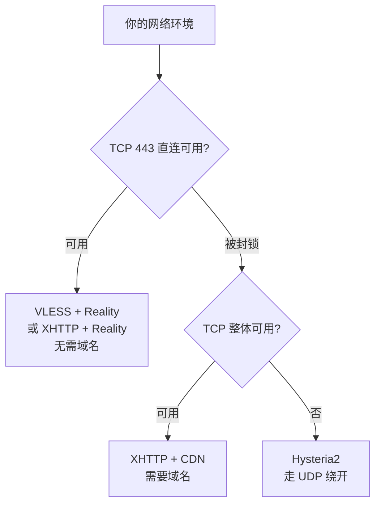
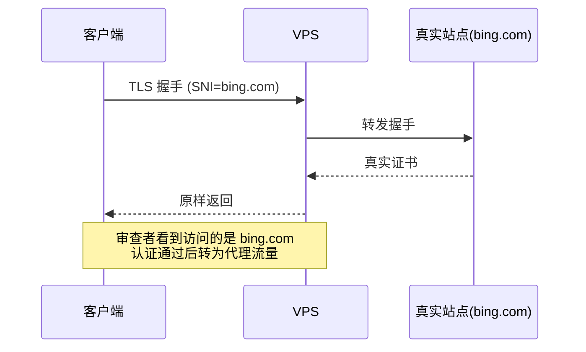
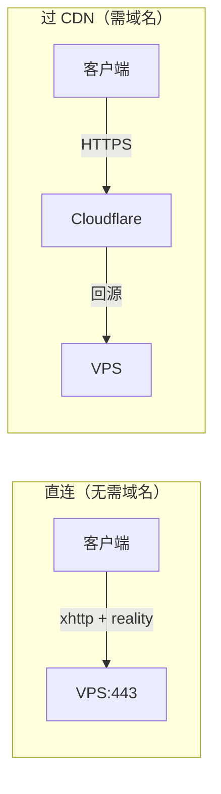

# Personal-Proxy

三个协议的部署指南：**VLESS**、**XHTTP**、**Hysteria2**。

> 仓库不含任何真实节点、IP、域名或密钥，全部用 `{{PLACEHOLDER}}` 占位。
> Agent 规范见 [`AGENTS.md`](./AGENTS.md) ｜ 版本基线见 [`VERSIONS.md`](./VERSIONS.md)

---

# 一、三种协议

## 对比

| | **VLESS** | **XHTTP** | **Hysteria2** |
|---|---|---|---|
| 类型 | 协议 | **传输层**（配 VLESS 用） | 协议 |
| 传输 | TCP 443 | TCP，可过 CDN | UDP 443 |
| 需要域名 | ❌ | 直连 ❌ / 过 CDN ✅ | ❌ |
| 需要证书 | ❌（Reality 借用） | ❌（直连）/ ✅（过 CDN） | 自签即可 |
| 抗主动探测 | ⭐⭐⭐ | ⭐⭐ | ⭐⭐ |
| 弱网性能 | ⭐⭐ | ⭐⭐ | ⭐⭐⭐ |
| 过 CDN | ❌ | ⭐⭐⭐ 唯一支持 | ❌ |
| 成熟度 | ⭐⭐⭐ 最稳定 | ⭐⭐ 演进中 | ⭐⭐⭐ |

## 各自解决什么问题



- **VLESS** — 伪装成真实网站，最成熟。解决「直连时如何不被识别」
- **XHTTP** — 传输层，提供上下行分离、TLS 1.2、可过 CDN。解决「需要进阶伪装或 IP 被封」
- **Hysteria2** — 基于 QUIC，激进拥塞控制。解决「TCP 受限或弱网」

三者互补，可同时部署。

## VLESS 原理



用 **REALITY** 借用真实站点的证书和握手，**不需要自己申请证书**，也无法被主动探测识别。

配 `xtls-rprx-vision` 流控消除 TLS-in-TLS 特征。

## XHTTP 原理

XHTTP 是**传输层**，不是独立协议。



四个独立优势：

| 优势 | 说明 |
|---|---|
| **可用 TLS 1.2** | Reality 只能用 TLS 1.3，某些地区已封锁 TLS 1.3 |
| **上下行分离** | 发包和收包可走完全不同路径（IPv4/IPv6、直连/CDN、不同国家） |
| **流量混淆** | `packet-up`/`stream-up` 拆成双连接，天然规避 TLS-in-TLS |
| **可过 CDN** | 藏在 CDN 后面，抬高封锁成本 |

> XHTTP 不能配 `xtls-rprx-vision`，`flow` 必须留空。

## Hysteria2 原理

基于 QUIC（UDP），自带 Brutal 拥塞控制，丢包严重时仍能跑满带宽。配 Salamander 混淆可干扰运营商的 QUIC 流量识别。

---

# 二、服务端配置

## 通用前置

### SSH 安全登录

**先确保密钥登录可用，再动任何网络配置**，否则可能把自己锁在门外。

```bash
ssh-keygen -t ed25519 -C "proxy-vps"
ssh-copy-id -i ~/.ssh/id_ed25519.pub root@{{VPS_IP}}
```

本地 `~/.ssh/config`：

```sshconfig
Host {{NODE_NAME}}
    HostName {{VPS_IP}}
    User root
    Port {{SSH_PORT}}
    IdentityFile ~/.ssh/id_ed25519
    IdentitiesOnly yes
```

验证无密码登录成功后，才考虑禁用密码认证：

```bash
sed -i 's/^#\?PasswordAuthentication.*/PasswordAuthentication no/' /etc/ssh/sshd_config
systemctl restart ssh
```

> ⚠️ 改前先开第二个终端确认密钥能登录。建议同时把 SSH 改到非标准端口。

### 端口规划

| 组合 | 是否冲突 |
|---|---|
| Xray TCP 443 + Hysteria UDP 443 | ✅ 不冲突（协议号不同）|
| Xray VLESS :443 + Xray XHTTP :443 | ❌ 冲突，同一进程两个 TCP 入站不能同端口 |

所以 VLESS 和 XHTTP 若都在 Xray 里，必须用不同端口，或只选一个。

---

## 2.1 VLESS 服务端

### 安装 Xray

```bash
bash -c "$(curl -L https://github.com/XTLS/Xray-install/raw/main/install-release.sh)" @ install
xray version
```

### 生成密钥

```bash
# REALITY 密钥对
xray x25519
# 输出：PrivateKey（服务端用）+ Password/PublicKey（客户端用）

# UUID
xray uuid
```

> ⚠️ 公私钥不能写反：服务端存私钥，客户端存公钥。

### 选择目标站点

`{{REALITY_TARGET}}` 必须满足：

| 要求 | 说明 |
|---|---|
| 境外站点 | 不能是国内站点 |
| 支持 TLSv1.3 + H2 | 必须 |
| 域名不重定向 | `example.com` → `www.example.com` 这种不行 |
| 延迟低 | 与 VPS 地理位置近 |

验证目标可用：

```bash
openssl s_client -connect {{REALITY_TARGET}}:443 -servername {{REALITY_TARGET}} \
  -tls1_3 -alpn h2 </dev/null 2>&1 | grep -E "Protocol|ALPN"
# 应显示 TLSv1.3 和 ALPN protocol: h2
```

### 配置

`/usr/local/etc/xray/config.json`：

```jsonc
{
  "log": { "loglevel": "warning" },
  "inbounds": [
    {
      "tag": "vless",
      "listen": "0.0.0.0",
      "port": 443,
      "protocol": "vless",
      "settings": {
        "clients": [
          {
            "id": "{{UUID}}",
            // ★ 必须带 flow，裸 VLESS 已被 Xray 弃用
            "flow": "xtls-rprx-vision"
          }
        ],
        "decryption": "none"
      },
      "streamSettings": {
        // 旧版写 "tcp"，新版称 "raw"，二者兼容
        "network": "raw",
        "security": "reality",
        "realitySettings": {
          "show": false,
          // 新版字段名为 target，旧版 dest
          "dest": "{{REALITY_TARGET}}:443",
          "serverNames": ["{{REALITY_TARGET}}"],
          "privateKey": "{{REALITY_PRIVATE_KEY}}",
          "shortIds": ["{{REALITY_SHORT_ID}}"]
        }
      },
      "sniffing": {
        "enabled": true,
        "destOverride": ["http", "tls", "quic"]
      }
    }
  ],
  "outbounds": [{ "protocol": "freedom" }]
}
```

### 启动与自检

```bash
systemctl enable --now xray
systemctl is-active xray
ss -tlnp | grep :443
journalctl -u xray -n 30 --no-pager

# 服务端自检：应返回目标站点真实证书
openssl s_client -connect {{LOCALHOST}}:443 -servername {{REALITY_TARGET}} </dev/null 2>&1 \
  | grep -E "subject=|Verify return code"
```

---

## 2.2 XHTTP 服务端

两种方案，按是否需要域名选。

### 方案 A：XHTTP + Reality（无需域名）

靠 Reality 借用别人的站点完成 TLS，零域名零证书。

```jsonc
{
  "log": { "loglevel": "warning" },
  "inbounds": [
    {
      "tag": "xhttp",
      "listen": "0.0.0.0",
      "port": 443,
      "protocol": "vless",
      "settings": {
        "clients": [
          {
            "id": "{{UUID}}",
            // XHTTP 不能用 Vision flow，必须留空
            "flow": ""
          }
        ],
        "decryption": "none"
      },
      "streamSettings": {
        "network": "xhttp",
        "xhttpSettings": {
          "path": "/{{XHTTP_PATH}}"
        },
        // 用 Reality 完成 TLS，不需要自己的证书
        "security": "reality",
        "realitySettings": {
          "show": false,
          "target": "{{REALITY_TARGET}}:443",
          "serverNames": ["{{REALITY_TARGET}}"],
          "privateKey": "{{REALITY_PRIVATE_KEY}}",
          "shortIds": ["{{REALITY_SHORT_ID}}"]
        }
      },
      "sniffing": {
        "enabled": true,
        "destOverride": ["http", "tls", "quic"]
      }
    }
  ],
  "outbounds": [{ "protocol": "freedom" }]
}
```

### 方案 B：XHTTP + CDN（需要域名）

**前置**：

1. 一个域名，托管到 Cloudflare
2. 建子域名（如 `{{CDN_DOMAIN}}`），**开启橙色云朵**
3. Cloudflare 面板 → 网络 → 启用 **gRPC**

**证书**：

```bash
# 方案一：acme.sh
curl https://get.acme.sh | sh -s email={{EMAIL}}
~/.acme.sh/acme.sh --issue -d {{CDN_DOMAIN}} --standalone

# 方案二：Cloudflare Origin Certificate（更简单，仅 CF 回源有效）
# CF 面板 → SSL/TLS → Origin Server → 创建证书
```

**配置**：

```jsonc
{
  "log": { "loglevel": "warning" },
  "inbounds": [
    {
      "tag": "xhttp-cdn",
      "listen": "0.0.0.0",
      "port": {{XHTTP_PORT}},
      "protocol": "vless",
      "settings": {
        "clients": [{ "id": "{{UUID}}", "flow": "" }],
        "decryption": "none"
      },
      "streamSettings": {
        "network": "xhttp",
        "security": "tls",
        "tlsSettings": {
          "certificates": [
            {
              "certificateFile": "/etc/xray/certs/fullchain.pem",
              "keyFile": "/etc/xray/certs/key.pem"
            }
          ],
          "alpn": ["h2", "http/1.1"]
        },
        "xhttpSettings": {
          "path": "/{{XHTTP_PATH}}",
          // auto: h2 用 stream-up，h3 用 packet-up
          "mode": "auto"
        }
      },
      "sniffing": {
        "enabled": true,
        "destOverride": ["http", "tls", "quic"]
      }
    }
  ],
  "outbounds": [{ "protocol": "freedom" }]
}
```

### 启动与自检

```bash
systemctl restart xray
systemctl is-active xray
ss -tlnp | grep :443
journalctl -u xray -n 30 --no-pager
```

### 三种模式

| 模式 | 特点 | 适用 |
|---|---|---|
| `packet-up` | 最慢但兼容性最强 | 无法穿透 CDN/反代时的保底 |
| `stream-up` | 较快，需特定服务端配置 | 常规 CDN |
| `stream-one` | 单连接双向 | Nginx `grpc_pass` 或 CF 开 gRPC |
| `auto` | 按 ALPN 自动选择 | 默认推荐 |

---

## 2.3 Hysteria2 服务端

### 安装

```bash
bash <(curl -fsSL https://get.hy2.sh/)
```

### 生成自签证书

```bash
mkdir -p /etc/hysteria
openssl req -x509 -nodes -newkey ec -pkeyopt ec_paramgen_curve:prime256v1 \
  -keyout /etc/hysteria/key.pem -out /etc/hysteria/cert.pem \
  -subj "/CN={{SERVER_NAME}}" -days 3650
chmod 600 /etc/hysteria/key.pem
chown -R hysteria:hysteria /etc/hysteria
```

> 自签证书完全可用，客户端跳过校验即可，**不需要申请 Let's Encrypt**。

### 配置

`/etc/hysteria/config.yaml`：

```yaml
listen: :{{HY2_PORT}}

tls:
  cert: /etc/hysteria/cert.pem
  key: /etc/hysteria/key.pem

auth:
  type: password
  password: {{HY2_PASSWORD}}

obfs:
  type: salamander
  salamander:
    password: {{HY2_OBFS_PASSWORD}}

masquerade:
  type: proxy
  proxy:
    url: https://www.bing.com
    rewriteHost: true
```

### 启动

```bash
systemctl enable --now hysteria-server
systemctl is-active hysteria-server
ss -ulnp | grep :{{HY2_PORT}}
```

若无 systemd unit（手动装的二进制），创建 `/etc/systemd/system/hysteria-server.service`：

```ini
[Unit]
Description=Hysteria Server
After=network.target

[Service]
Type=simple
ExecStart=/usr/local/bin/hysteria server --config /etc/hysteria/config.yaml
User=hysteria
Group=hysteria
CapabilityBoundingSet=CAP_NET_ADMIN CAP_NET_BIND_SERVICE CAP_NET_RAW
AmbientCapabilities=CAP_NET_ADMIN CAP_NET_BIND_SERVICE CAP_NET_RAW
NoNewPrivileges=true
Restart=on-failure

[Install]
WantedBy=multi-user.target
```

```bash
useradd -r -s /sbin/nologin hysteria || true
systemctl daemon-reload && systemctl enable --now hysteria-server
```

---

# 三、客户端配置

统一使用 **Clash Verge Rev**（mihomo 内核，纯 YAML 配置），三个协议均原生支持。

## 配置文件位置

```text
Windows: %APPDATA%\io.github.clash-verge-rev.clash-verge-rev\profiles\
macOS:   ~/Library/Application Support/io.github.clash-verge-rev.clash-verge-rev/profiles/
Linux:   ~/.config/io.github.clash-verge-rev.clash-verge-rev/profiles/
```

## 3.1 VLESS 客户端

```yaml
proxies:
  - name: "VLESS"
    type: vless
    server: {{VPS_IP}}
    port: 443
    uuid: {{UUID}}
    network: tcp
    tls: true
    udp: true
    # ★ 必须与服务端 flow 一致
    flow: xtls-rprx-vision
    servername: {{REALITY_TARGET}}
    client-fingerprint: chrome
    reality-opts:
      public-key: {{REALITY_PUBLIC_KEY}}
      short-id: {{REALITY_SHORT_ID}}
```

## 3.2 XHTTP 客户端

**方案 A（直连）**：

```yaml
proxies:
  - name: "XHTTP-DIRECT"
    type: vless
    server: {{VPS_IP}}
    port: 443
    uuid: {{UUID}}
    network: xhttp
    tls: true
    udp: true
    # XHTTP 不能用 Vision flow
    flow: ""
    servername: {{REALITY_TARGET}}
    client-fingerprint: chrome
    reality-opts:
      public-key: {{REALITY_PUBLIC_KEY}}
      short-id: {{REALITY_SHORT_ID}}
    xhttp-opts:
      path: "/{{XHTTP_PATH}}"
      mode: auto
```

**方案 B（过 CDN）**：

```yaml
proxies:
  - name: "XHTTP-CDN"
    type: vless
    server: {{CDN_DOMAIN}}
    port: 443
    uuid: {{UUID}}
    network: xhttp
    tls: true
    udp: true
    flow: ""
    servername: {{CDN_DOMAIN}}
    client-fingerprint: chrome
    xhttp-opts:
      path: "/{{XHTTP_PATH}}"
      mode: auto
      # CDN 转发所需的 HTTP Host
      host: {{CDN_DOMAIN}}
```

## 3.3 Hysteria2 客户端

```yaml
proxies:
  - name: "HY2"
    type: hysteria2
    server: {{VPS_IP}}
    port: {{HY2_PORT}}
    password: {{HY2_PASSWORD}}
    # 自签证书必须为 true
    skip-cert-verify: true
    sni: {{SERVER_NAME}}
    # 按 VPS 实际带宽填写
    up: "{{UP_MBPS}}"
    down: "{{DOWN_MBPS}}"
    obfs: salamander
    obfs-password: {{HY2_OBFS_PASSWORD}}
    alpn:
      - h3
```

## 3.4 组合配置

把上面三个节点放入同一个配置文件，配合分组与分流规则：

```yaml
proxy-groups:
  - name: "🚀 节点选择"
    type: select
    proxies: ["VLESS", "XHTTP-DIRECT", "HY2", "♻️ 自动选择"]

  - name: "♻️ 自动选择"
    type: url-test
    proxies: ["VLESS", "XHTTP-DIRECT", "HY2"]
    url: "http://www.gstatic.com/generate_204"
    interval: 300
    tolerance: 50

  - name: "🤖 AI 服务"
    type: select
    proxies: ["🚀 节点选择", "WARP"]

rules:
  # 局域网直连
  - GEOIP,PRIVATE,DIRECT

  # AI 服务走独立出口（避免机房 IP 风控）
  - DOMAIN-SUFFIX,openai.com,🤖 AI 服务
  - DOMAIN-SUFFIX,chatgpt.com,🤖 AI 服务
  - DOMAIN-SUFFIX,anthropic.com,🤖 AI 服务
  - DOMAIN-SUFFIX,claude.ai,🤖 AI 服务
  - DOMAIN-SUFFIX,gemini.google.com,🤖 AI 服务

  - MATCH,🚀 节点选择
```

完整示例见 [`examples/client-mihomo.yaml`](./examples/client-mihomo.yaml)。

## 3.5 验证

```bash
curl -s -o /dev/null -w "%{http_code}\n" --max-time 15 \
  --socks5-hostname {{LOCALHOST}}:7897 https://www.gstatic.com/generate_204
# 期望 204
```

## 3.6 客户端自动化（可选）

Clash Verge 支持 REST API。

**前置**：设置 → 外部控制 → 开启，记下监听地址与密钥。

```bash
API="http://{{CLASH_API_HOST}}:9097"
KEY="{{CLASH_API_KEY}}"

# 查状态
curl -H "Authorization: Bearer $KEY" "$API/version"
curl -H "Authorization: Bearer $KEY" "$API/proxies"

# 切节点（返回 204 表示成功）
curl -X PUT -H "Authorization: Bearer $KEY" -H "Content-Type: application/json" \
     -d '{"name":"节点名"}' "$API/proxies/分组名"

# 测延迟
curl -H "Authorization: Bearer $KEY" \
     "$API/proxies/节点名/delay?timeout=5000&url=http%3A%2F%2Fwww.gstatic.com%2Fgenerate_204"
```

> 节点名含 emoji 或中文时必须 URL 编码。

---

# 排障

## 分层验证顺序

```text
1. 服务端进程活着        systemctl is-active
2. 端口在监听            ss -tulnp
3. 服务端本机自连可用    openssl s_client 连 {{LOCALHOST}}
4. 客户端能连上服务端    tcpdump 看 SYN/SYN-ACK
5. 客户端能出网          curl --socks5 访问外部
6. 延迟合理              REST API 测速
```

## ⚠️ 先确认本地没开 TUN

客户端开启 TUN 后接管全部流量，此时任何「直连测试」实际都走了代理，会得到 **1ms 延迟、1 跳直达**的假象。

```powershell
# Windows
Get-NetRoute -DestinationPrefix '0.0.0.0/0' | Sort-Object RouteMetric
Find-NetRoute -RemoteIPAddress {{VPS_IP}}
```

```bash
# Linux / macOS
ip route get {{VPS_IP}}
```

若 `InterfaceAlias` 是 `singbox_tun` / `clash_tun` / `Mihomo`，**测试结果无效**。

## 服务端抓包判读

```bash
tcpdump -n -i any "host {{CLIENT_IP}} and tcp port 443" -c 20 -v
```

| 现象 | 结论 | 处理 |
|---|---|---|
| SYN 未到达 | 去程阻断 / 端口被过滤 | 换端口验证；长期用 UDP 或过 CDN |
| SYN 到达、无 SYN-ACK | 服务端未监听 / 本机防火墙 | 查 `ss -tlnp`、`iptables -L -n` |
| SYN 到达、SYN-ACK 已发、客户端仍超时 | 回程阻断 | 换 IP 或走 CDN |

## 高频问题

| 症状 | 原因 | 处理 |
|---|---|---|
| `x509: certificate signed by unknown authority` | 自签证书未跳过校验 | mihomo 设 `skip-cert-verify: true` |
| 本机自连成功、外部全失败 | 进程未重启，配置漂移 | `systemctl restart xray` |
| 警告 `VLESS with no Flow is deprecated` | 裸 VLESS 已弃用 | 加 `flow: "xtls-rprx-vision"` |
| XHTTP 报错或不工作 | 版本不一致 | 客户端与服务端 Xray 版本必须一致 |
| 端口可达但协议不通 | 可能被 CDN/反代代答 | 必须做端到端验证 |
| VLESS 换端口后更快被封 | 官方明确警告 | 坚持用 443 |

## 配置不能跨内核复制

| 功能 | Xray | mihomo |
|---|---|---|
| 跳过证书校验 | `pinnedPeerCertSha256`（字符串） | `skip-cert-verify: true` |
| 传输层名 | `network: "xhttp"` | `network: xhttp` |
| XHTTP 参数块 | `xhttpSettings` | `xhttp-opts` |
| Flow 字段 | `settings.clients[].flow` | `flow: xtls-rprx-vision` |

---

# 反模式清单

| ❌ 不要这样做 | 为什么 |
|---|---|
| 先用密码登录，之后再改密钥 | 公网暴露会被持续爆破 |
| 改防火墙前不确认 SSH 端口 | 可能直接锁死自己 |
| **裸 VLESS 不配 Flow** | 已弃用，抗检测能力差 |
| **XHTTP 配 `xtls-rprx-vision`** | XHTTP 不支持 Vision flow |
| VLESS+Reality 跑在非 443 端口 | 官方警告会加速 IP 被封 |
| VLESS 和 XHTTP 同时占用 443 | 同一进程端口冲突 |
| 跨内核复制配置 | 字段名不同，会静默失败 |
| 假设 TCP 端口通 = 服务可用 | 裸连通过不代表协议层能跑 |
| 改完配置不重启进程 | 磁盘与内存配置不一致 |

---

# 版本与安全

**最后核对：2026-11-01** ｜ 详见 [`VERSIONS.md`](./VERSIONS.md)

| 组件 | 当前版本 | 发布 |
|---|---|---|
| Xray-core | v26.10.31 | 2026-10-31 |
| Hysteria2 | v2.x | — |
| mihomo | v1.19.33 | 2026-10-21 |
| Clash Verge Rev | v2.5.8 | 2026-10-09 |

## ⚠️ 安全公告

**Xray v26.10.31 是紧急安全更新**：Linux 内核被爆出监听 IPv4 MPTCP 极易被远程利用获取 root 权限，而 Go 1.24+ 默认开启 MPTCP。该版本默认关闭 MPTCP 以减小攻击面。

**建议**：尽快升级 Xray 至 v26.10.31+，并同步更新 Linux 内核。

## 破坏性变更

| 组件 | 变更 | 替代 |
|---|---|---|
| Xray | 裸 VLESS（无 Flow）弃用 | 加 `flow: "xtls-rprx-vision"` |
| Xray | 移除 `allowInsecure` | `pinnedPeerCertSha256` |
| Xray | `tcp` 传输改称 `raw` | 旧名仍兼容 |
| Xray | `dest` 改称 `target` | 旧名仍兼容 |

---

# 参考资料

- Xray-core — <https://github.com/XTLS/Xray-core>
- REALITY 文档 — <https://xtls.github.io/config/transports/reality.html>
- Xray 官方示例 — <https://github.com/XTLS/Xray-examples>
- XHTTP 详解 — <https://github.com/XTLS/Xray-core/discussions/4113>
- XHTTP 五合一配置 — <https://github.com/XTLS/Xray-core/discussions/4118>
- VLESS Flow 迁移 — <https://github.com/XTLS/Xray-core/discussions/5568>
- Hysteria2 — <https://v2.hysteria.network/>
- mihomo 文档 — <https://wiki.metacubex.one>
- Clash Verge Rev — <https://github.com/clash-verge-rev/clash-verge-rev>
- AGENTS.md 规范 — <https://agents.md>