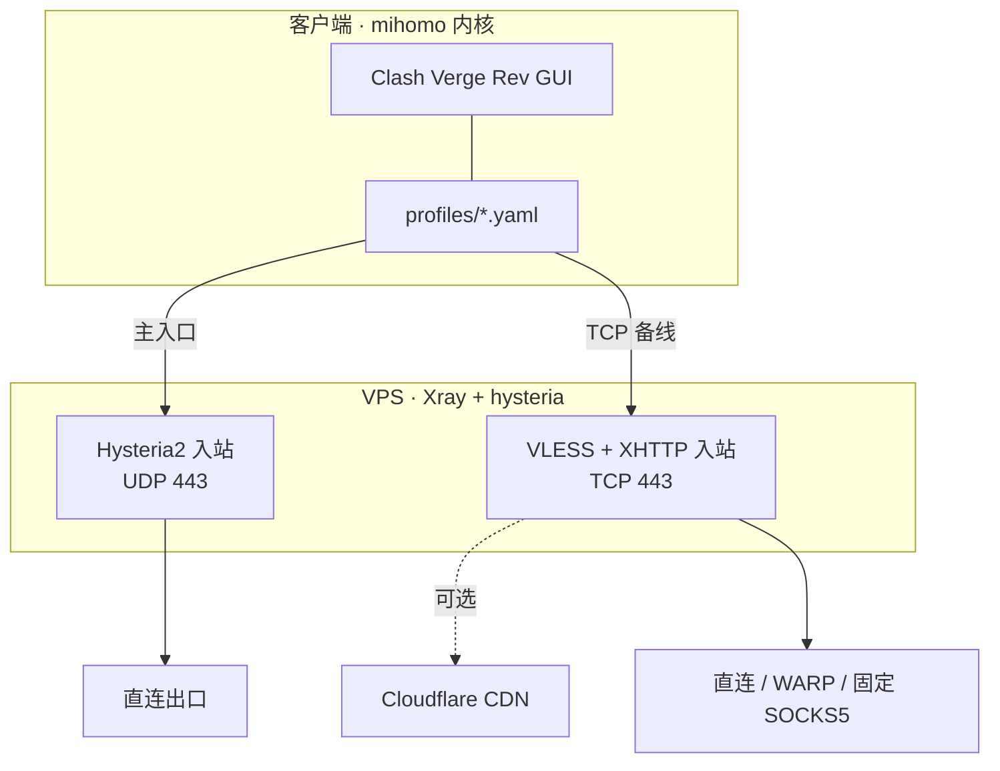

# Personal-Proxy

> 一套可复用的个人代理部署方案：**Hysteria2 作为主入口，VLESS + XHTTP 作为 TCP 备线**，附人类可读文档与 AI Agent 可直接执行的规范。
>
> 仓库内不含任何真实节点、IP、域名或密钥，所有敏感值以 `{{PLACEHOLDER}}` 占位。

[给 AI / Agent 的部署与维护说明 → `AGENTS.md`](./AGENTS.md)

---

## 先说结论

| 层 | 选择 | 理由 |
|---|---|---|
| **主入口协议** | Hysteria2 | UDP/QUIC，弱网抢带宽最强，配置最简单 |
| **TCP 备线** | VLESS + XHTTP | 可过 CDN，能对抗 IP 级封锁 |
| **备用** | VLESS + REALITY | 仅在 IP 干净、需要 TLS 伪装时使用 |
| **服务端内核** | Xray-core | XHTTP 与 REALITY 的发源地，实现最完整 |
| **客户端内核** | mihomo | REST API 完整，规则分流最强，订阅兼容最好 |
| **客户端 GUI** | Clash Verge Rev | 底层即 mihomo，配置是透明 YAML |

> **服务端与客户端的内核不必相同。** 协议是双方共同遵守的约定，只要两端都实现同一协议即可互通。

---

## 架构



两种入口解决的是不同问题：

- **Hysteria2** — 走 UDP，适合 UDP 通畅但 TCP 受限的网络
- **XHTTP** — 走 TCP 且可套 CDN，适合直连 IP 被针对封锁的网络

---

## 快速开始

```text
1. 准备 VPS（Debian/Ubuntu，root 权限，可选一个域名）
        ↓
2. 配置 SSH 公钥登录（禁用密码）
        ↓
3. 部署 Hysteria2 主入口 → 客户端验证连通
        ↓
4. 按需增加 XHTTP 作为 TCP 备线
        ↓
5. 配置分流（AI 服务走独立出口）
```

分步命令见 [`docs/best-practices.md`](./docs/best-practices.md)。

---

## 文档导航

| 文档 | 读者 | 内容 |
|---|---|---|
| [`docs/best-practices.md`](./docs/best-practices.md) | 人类 | 完整部署流程与最佳实践 |
| [`docs/troubleshooting.md`](./docs/troubleshooting.md) | 人类 | 排障决策树与常见失效场景 |
| [`docs/warp-outbound.md`](./docs/warp-outbound.md) | 人类 | WARP 出口配置与验证 |
| [`AGENTS.md`](./AGENTS.md) | **AI Agent** | 命令、边界、校验清单、版本漂移流程 |
| [`VERSIONS.md`](./VERSIONS.md) | 人 + Agent | 版本基线与核对时间 |
| [`examples/`](./examples/) | 人 + Agent | 可直接参考的完整配置示例 |

---

## 安全声明

本仓库**只包含占位符**。真实部署时：

- 密钥、UUID、私钥、域名一律**不得提交入库**
- 本地真实值放在 `local/`（已在 `.gitignore` 中排除）
- 提交前 CI 会自动扫描 IP、UUID、私钥特征

---

## 版本

最后核对：**2026-11** ｜ 详见 [`VERSIONS.md`](./VERSIONS.md)

代理生态变化较快，落地前请以当前版本实测为准。
