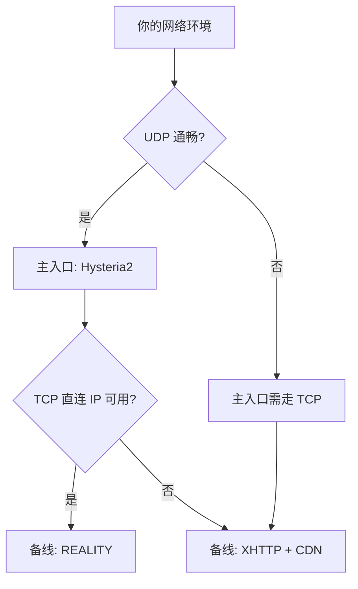
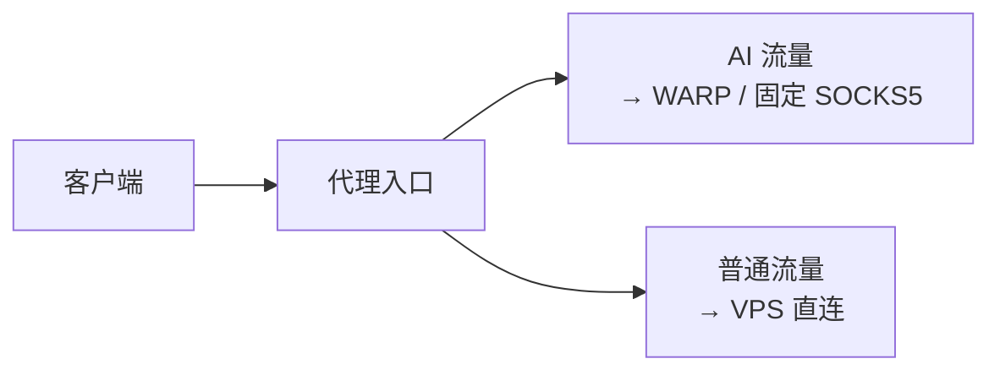

# 最佳实践

本文是完整的部署流程。面向人类读者，但所有命令均可直接复制执行。

> 版本基准见 [`../VERSIONS.md`](../VERSIONS.md)。落地前请以当前版本实测为准。

---

## 0. 适用性声明

本文假设：

| 项 | 假设值 | 不符时需调整 |
|---|---|---|
| 服务端系统 | Debian 11+ / Ubuntu 20.04+ | 包管理命令（apt → yum/dnf）|
| 服务端权限 | root | 绑定 443 端口需要特权 |
| SSH | 已配置公钥登录 | 见第 1 节 |
| 客户端 | Clash Verge Rev | 其他 mihomo 内核客户端同理 |
| 网络 | 拥有公网 IP 的 VPS | — |

**域名不是必需的**。Hysteria2 可用自签证书，REALITY 不需要证书，XHTTP 直连也不需要。只有套 CDN 时才必须有域名。

---

## 1. 前置：SSH 安全登录

**先确保密钥登录可用，再动任何网络配置**——否则可能把自己锁在门外。

```bash
# 本地生成密钥（已有可跳过）
ssh-keygen -t ed25519 -C "proxy-vps"

# 推送到服务器
ssh-copy-id -i ~/.ssh/id_ed25519.pub root@{{VPS_IP}}
```

本地 `~/.ssh/config` 建议：

```sshconfig
Host {{NODE_NAME}}
    HostName {{VPS_IP}}
    User root
    Port {{SSH_PORT}}
    IdentityFile ~/.ssh/id_ed25519
    IdentitiesOnly yes
```

验证**无密码**登录成功后，再考虑禁用密码认证：

```bash
sed -i 's/^#\?PasswordAuthentication.*/PasswordAuthentication no/' /etc/ssh/sshd_config
systemctl restart ssh
```

> ⚠️ 改 `sshd_config` 前先开第二个终端确认密钥能登录，避免配置写错后无法连接。

---

## 2. 协议选型

### 决策依据



### 三种入口的定位

| 协议 | 传输 | 优势 | 适用前提 |
|---|---|---|---|
| **Hysteria2** | UDP/QUIC | 弱网抢带宽最强，配置最简单 | UDP 未被限速或阻断 |
| **VLESS + XHTTP** | TCP，可过 CDN | 能对抗 IP 级封锁，可套 CDN | 需要一个域名（套 CDN 时）|
| **VLESS + REALITY** | TCP | 伪装真实站点，无需域名证书 | 服务端 IP 未被针对 |

**核心判断**：REALITY 依赖 IP 干净，一旦 IP 被标记就完全失效。XHTTP 把流量藏在 CDN 后面，封锁成本高得多——GFW 不会轻易封锁大型 CDN 的整个 IP，否则会波及大量正常网站。

**推荐组合**：Hysteria2 作主入口 + XHTTP 作 TCP 备线，两者独立，任一失效不影响另一条。

---

## 3. 服务端：部署 Hysteria2

### 3.1 安装

```bash
bash <(curl -fsSL https://get.hy2.sh/)
```

### 3.2 生成自签证书

```bash
mkdir -p /etc/hysteria
openssl req -x509 -nodes -newkey ec -pkeyopt ec_paramgen_curve:prime256v1 \
  -keyout /etc/hysteria/key.pem -out /etc/hysteria/cert.pem \
  -subj "/CN={{SERVER_NAME}}" -days 3650
chmod 600 /etc/hysteria/key.pem
```

> 自签证书**完全可用**。客户端跳过校验即可，安全性上可配合证书固定（pinning）比盲目信任更严格。**不需要专门申请 Let's Encrypt**。

### 3.3 配置

`/etc/hysteria/config.yaml`：

```yaml
listen: :443

tls:
  cert: /etc/hysteria/cert.pem
  key: /etc/hysteria/key.pem

auth:
  type: password
  password: {{HY2_PASSWORD}}

obfs:
  type: salamander
  salamander:
    password: {{HY2_OBFS_PASSWORD}}

masquerade:
  type: proxy
  proxy:
    url: https://www.bing.com
    rewriteHost: true
```

### 3.4 启动与验证

Hysteria 官方安装脚本会创建 systemd unit：

```bash
systemctl enable --now hysteria-server
systemctl is-active hysteria-server
ss -ulnp | grep :443
journalctl -u hysteria-server -n 30 --no-pager
```

若你的环境**没有** systemd unit（例如手动解压二进制），需自行创建：

```ini
# /etc/systemd/system/hysteria-server.service
[Unit]
Description=Hysteria Server
After=network.target

[Service]
Type=simple
ExecStart=/usr/local/bin/hysteria server --config /etc/hysteria/config.yaml
User=hysteria
Group=hysteria
CapabilityBoundingSet=CAP_NET_ADMIN CAP_NET_BIND_SERVICE CAP_NET_RAW
AmbientCapabilities=CAP_NET_ADMIN CAP_NET_BIND_SERVICE CAP_NET_RAW
NoNewPrivileges=true
Restart=on-failure

[Install]
WantedBy=multi-user.target
```

```bash
useradd -r -s /sbin/nologin hysteria || true
chown -R hysteria:hysteria /etc/hysteria
systemctl daemon-reload && systemctl enable --now hysteria-server
```

---

## 4. 服务端：部署 Xray（XHTTP / REALITY）

### 4.1 安装

```bash
bash -c "$(curl -L https://github.com/XTLS/Xray-install/raw/main/install-release.sh)" @ install
xray version
```

### 4.2 生成 REALITY 密钥对（仅 REALITY 需要）

```bash
xray x25519
```

输出中：

- **PrivateKey** → 写入服务端配置
- **Password/PublicKey** → 分发给客户端

> ⚠️ 两者不可写反：服务端存私钥，客户端存公钥。

### 4.3 配置

`/usr/local/etc/xray/config.json`：

```jsonc
{
  "log": { "loglevel": "warning" },
  "inbounds": [
    {
      // XHTTP 入口（TCP，可套 CDN）
      "tag": "xhttp",
      "listen": "0.0.0.0",
      "port": 443,
      "protocol": "vless",
      "settings": {
        "clients": [{ "id": "{{UUID}}" }],
        "decryption": "none"
      },
      "streamSettings": {
        "network": "xhttp",
        "security": "none",
        "xhttpSettings": { "path": "{{XHTTP_PATH}}" }
      },
      "sniffing": { "enabled": true, "destOverride": ["http", "tls", "quic"] }
    },
    {
      // REALITY 入口（仅当不使用 XHTTP 时启用）
      "tag": "reality",
      "listen": "0.0.0.0",
      "port": {{REALITY_PORT}},
      "protocol": "vless",
      "settings": {
        "clients": [{ "id": "{{UUID}}" }],
        "decryption": "none"
      },
      "streamSettings": {
        "network": "tcp",
        "security": "reality",
        "realitySettings": {
          "show": false,
          "dest": "{{REALITY_TARGET}}:443",
          "serverNames": ["{{REALITY_TARGET}}"],
          "privateKey": "{{REALITY_PRIVATE_KEY}}",
          "shortIds": ["{{REALITY_SHORT_ID}}"]
        }
      }
    }
  ],
  "outbounds": [{ "protocol": "freedom" }]
}
```

**注意**：两个入站不能同时占用 443。二选一，或给 REALITY 换端口（但不建议，见 5.3）。

### 4.4 启动与验证

```bash
systemctl enable --now xray
systemctl is-active xray
ss -tlnp | grep :443
journalctl -u xray -n 30 --no-pager
```

服务端本机自连验证（排除客户端因素）：

```bash
# REALITY：应返回真实站点证书
openssl s_client -connect 127.0.0.1:{{REALITY_PORT}} -servername {{REALITY_TARGET}} </dev/null 2>&1 \
  | grep -E "subject=|Verify return code"
```

---

## 5. 客户端：Clash Verge Rev

### 5.1 添加节点

配置文件位于：

```text
Windows: %APPDATA%\io.github.clash-verge-rev.clash-verge-rev\profiles\
macOS:   ~/Library/Application Support/io.github.clash-verge-rev.clash-verge-rev/profiles/
Linux:   ~/.config/io.github.clash-verge-rev.clash-verge-rev/profiles/
```

Hysteria2 节点示例见 [`../examples/client-mihomo.yaml`](../examples/client-mihomo.yaml)。

### 5.2 开启 REST API（Agent 自动化必需）

GUI：**设置 → 外部控制 → 开启**，记下监听地址与 API 密钥。

或改 `verge.yaml`：

```yaml
enable_external_controller: true
```

验证：

```bash
curl -H "Authorization: Bearer {{CLASH_API_KEY}}" "http://{{CLASH_API_HOST}}:9097/version"
# 期望: {"meta":true,"version":"v1.19.x"}
```

### 5.3 自签证书处理

服务端用自签证书时，客户端必须显式跳过校验，否则报：

```text
x509: certificate signed by unknown authority
```

| 内核 | 写法 |
|---|---|
| mihomo / sing-box | `skip-cert-verify: true` / `tls.insecure: true` |
| Xray | `pinnedPeerCertSha256: "<指纹>"`（字符串，非数组）|

---

## 6. 验证方法

### 6.1 分层验证

按顺序排除，不要跳步：

```text
1. 服务端进程活着        systemctl is-active
2. 端口在监听            ss -tulnp
3. 服务端本机自连可用    openssl s_client / curl 连 127.0.0.1
4. 客户端能连上服务端    tcpdump 看 SYN/SYN-ACK
5. 客户端能出网          curl --socks5 访问外部
6. 延迟合理              /proxies/{name}/delay
```

### 6.2 关键：先确认本地没开 TUN

**这是最容易出错的一步。** 客户端开启 TUN 后接管全部流量，此时任何「直连测试」实际都走了代理，会得到 1ms、1 跳的假象。

```powershell
# Windows
Get-NetRoute -DestinationPrefix '0.0.0.0/0' | Sort-Object RouteMetric
Find-NetRoute -RemoteIPAddress {{VPS_IP}}
```

若 `InterfaceAlias` 是 `singbox_tun` / `clash_tun`，**测试结果无效**。

```bash
# Linux / macOS
ip route get {{VPS_IP}}
```

### 6.3 服务端抓包判读

```bash
tcpdump -n -i any "host {{CLIENT_IP}} and tcp port 443" -c 20 -v
```

| 现象 | 结论 | 下一步 |
|---|---|---|
| SYN 未到达 | 去程阻断 / 端口被过滤 | 换端口测试，或用 UDP 协议 |
| SYN 到达、无 SYN-ACK | 服务端未监听 / 本机防火墙 | 查 `ss -tlnp`、`iptables` |
| SYN 到达、SYN-ACK 已发、客户端超时 | 回程阻断 | 先排除 TUN 干扰再判定 |

---

## 7. 分流：AI 服务走独立出口

AI 服务（OpenAI、Claude、Gemini）对出口 IP 的地区与信誉敏感。把 AI 流量与普通流量解耦，更易维护。



关键在于区分两件事：

> **REALITY / XHTTP 解决「怎么进入 VPS」；WARP / SOCKS5 解决「VPS 从哪里出去」。**

加了更好的入口，并不会让 AI 看到更干净的出口 IP。

mihomo 规则示例：

```yaml
rules:
  - DOMAIN-SUFFIX,openai.com,AI
  - DOMAIN-SUFFIX,claude.ai,AI
  - DOMAIN-SUFFIX,anthropic.com,AI
  - DOMAIN-SUFFIX,gemini.google.com,AI
  - MATCH,DIRECT
```

WARP 出口配置见 [`warp-outbound.md`](./warp-outbound.md)。

---

## 8. 反模式清单

| ❌ 不要这样做 | 为什么 |
|---|---|
| 先用密码登录，之后再考虑密钥 | 密码认证暴露在公网上，会被持续爆破 |
| 改防火墙前不确认 SSH 端口 | 可能直接锁死自己 |
| REALITY 跑在非 443 端口 | Xray 官方警告会加速 IP 被封 |
| 跨内核复制配置 | 字段名不同，会静默失败 |
| 假设 TCP 端口通 = 服务可用 | 裸连通过不代表协议层能跑 |
| 只测客户端 | 无法区分是服务端问题还是链路问题 |
| 改完配置不重启进程 | 磁盘配置与内存不一致，行为异常 |
| 用自签证书就觉得不安全而努力申请证书 | 自签 + 证书固定足够，申请证书不是必需 |

---

## 9. 参考资料

- Hysteria2 官方 — <https://v2.hysteria.network/>
- Xray-core — <https://github.com/XTLS/Xray-core>
- XHTTP 详解 — <https://github.com/XTLS/Xray-core/discussions/4113>
- REALITY 文档 — <https://xtls.github.io/config/transports/reality.html>
- mihomo 文档 — <https://wiki.metacubex.one>
- Clash Verge Rev — <https://github.com/clash-verge-rev/clash-verge-rev>
