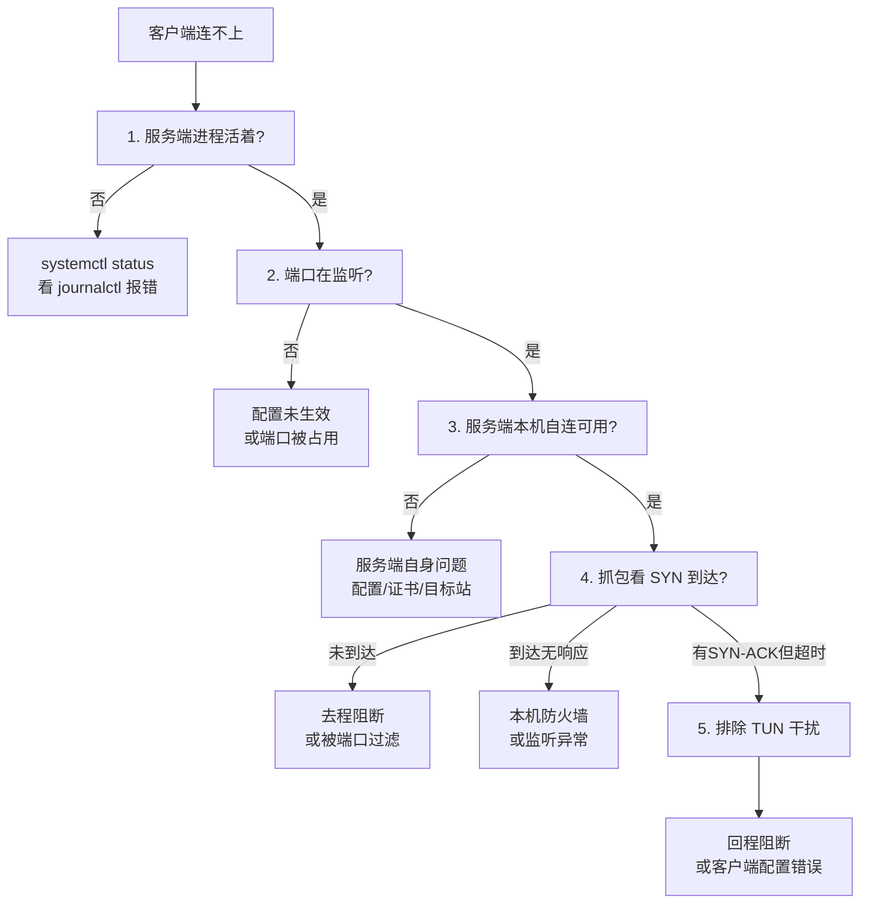

# 排障决策树

按症状定位。先完成每一层检查再进入下一层，不要跳步。

---

## 总体流程



---

## 场景 1：所有节点都不通

**先查本地网络，而不是服务器。**

```bash
curl -s -o /dev/null -w "%{http_code}\n" --max-time 10 https://www.gstatic.com/generate_204
```

若直连也不通，说明是本地网络问题，与代理无关。

---

## 场景 2：直连测试正常但代理不通

### 症状

- `ping` / `curl` 直连服务器成功
- 客户端却连不上

### 原因与处理

| 可能原因 | 验证 | 处理 |
|---|---|---|
| 协议层不匹配 | 服务端日志有无握手错误 | 核对 UUID / 密码 / 传输层 |
| 客户端内核不支持该协议 | 查内核协议列表 | 换内核（如 Hy2 用 sing-box/mihomo）|
| 证书校验失败 | 客户端日志有 `x509` | 自签证书需跳过校验 |
| 端口冲突 | `ss -tlnp` 看端口 | 改为不同端口 |

---

## 场景 3：报 `x509: certificate signed by unknown authority`

### 原因

服务端用自签证书，客户端按 CA 链校验必然失败。**这不是服务端配置错误。**

验证服务端证书确实自签：

```bash
openssl x509 -in /etc/hysteria/cert.pem -noout -subject -issuer
# Issuer 与 Subject 相同 → 自签
```

### 处理

| 内核 | 正确写法 |
|---|---|
| mihomo（Clash Verge）| `skip-cert-verify: true` |
| sing-box | `tls.insecure: true` |
| Xray | `pinnedPeerCertSha256: "<sha256指纹>"` |

获取指纹：

```bash
openssl x509 -in /etc/hysteria/cert.pem -noout -fingerprint -sha256 \
  | cut -d= -f2 | tr -d ':'
```

> **Xray 注意**：`allowInsecure` 已被移除；`verifyPeerCertByName` 只校验域名不信任签名，对自签无效。必须用证书固定。字段值是**字符串**，写成数组会报类型错误。

---

## 场景 4：本机自连成功，外部连接全部失败

### 这是典型的「配置漂移」

磁盘配置已改，但进程仍运行旧配置（内存中）。

```bash
systemctl restart xray
systemctl restart hysteria-server
journalctl -u xray -n 30 --no-pager
```

### 判断依据

| 现象 | 含义 |
|---|---|
| 本机自连 OK + 外部全失败 | 进程配置过期，或 Reality 密钥/短ID 不一致 |
| 本机自连也失败 | 服务端自身问题 |

---

## 场景 5：怀疑 IP 被封锁

### ⚠️ 第一步必须先排除 TUN

客户端开 TUN 后接管全部流量，此时「直连测试」实际走了代理，会显示 1ms、1 跳的假象。

```powershell
Get-NetRoute -DestinationPrefix '0.0.0.0/0' | Sort-Object RouteMetric
Find-NetRoute -RemoteIPAddress {{VPS_IP}}
# InterfaceAlias 是 tun 类接口 → 结果无效
```

```bash
ip route get {{VPS_IP}}
```

### 第二步：服务端抓包

```bash
tcpdump -n -i any "host {{CLIENT_IP}} and tcp port {{PORT}}" -c 20 -v
```

| 抓包现象 | 结论 | 处理 |
|---|---|---|
| SYN 未到达 | 去程阻断 / 端口被过滤 | 换端口验证；长期方案用 UDP 协议或 XHTTP+CDN |
| SYN 到达、无 SYN-ACK | 服务端没监听 / 本机防火墙 | 查 `ss -tlnp`、`iptables -L -n` |
| SYN 到达、SYN-ACK 已发出、客户端仍超时 | 回程阻断 | 需换 IP 或走 CDN |

### 第三步：横向对照

```bash
# 同机房邻居 IP 是否可达（判断是否整段被封）
curl -s -o /dev/null -w "%{http_code}\n" --max-time 8 https://127.0.0.1

# 其他境外站点是否正常（判断是否本机网络问题）
curl -s -o /dev/null -w "%{http_code}\n" --max-time 8 https://www.microsoft.com
```

---

## 场景 6：端口可达但协议不通

**裸 TCP 探测通过 ≠ 协议可用。** 前端可能有 CDN、反向代理或探活设备代答。

必须做**端到端验证**：

```bash
# 用客户端走该节点访问外部
curl -s -o /dev/null -w "%{http_code}\n" --max-time 15 \
  --socks5-hostname 127.0.0.1:{{LOCAL_SOCKS_PORT}} \
  https://www.gstatic.com/generate_204
```

期望 `204`。返回 `000` 说明协议层未打通。

---

## 场景 7：Clash Verge REST API 连不上

```bash
curl -H "Authorization: Bearer {{CLASH_API_KEY}}" "http://127.0.0.1:9097/version"
```

| 现象 | 原因 | 处理 |
|---|---|---|
| 连接被拒绝 | 外部控制器未开启 | 设置 → 外部控制 → 开启 |
| `401` | 密钥错误 | 核对 API 密钥 |
| 端口不通 | 监听地址不同 | 看 `config.yaml` 的 `external-controller` |

Clash Verge 默认使用**命名管道**而非 TCP，需在 GUI 中显式开启外部控制器才会监听端口。

---

## 场景 8：节点能连但很慢

| 检查项 | 方法 |
|---|---|
| 节点本身延迟 | `GET /proxies/{name}/delay?timeout=5000&url=...` |
| 是否走了错误分组 | `GET /proxies` 看分组当前选中的节点 |
| 是否被 CDN 拖慢 | 套 CDN 会多一跳，延迟通常上升 |
| UDP 是否被限速 | 对比 TCP 与 UDP 协议的速度 |

---

## 通用排查命令

```bash
# 服务端
systemctl status xray hysteria-server --no-pager
ss -tulnp
journalctl -u xray -n 50 --no-pager
journalctl -u hysteria-server -n 50 --no-pager
iptables -L -n -v
nft list ruleset

# 客户端（mihomo REST API）
curl -H "Authorization: Bearer {{CLASH_API_KEY}}" "http://127.0.0.1:9097/proxies"
curl -H "Authorization: Bearer {{CLASH_API_KEY}}" "http://127.0.0.1:9097/rules"
curl -H "Authorization: Bearer {{CLASH_API_KEY}}" "http://127.0.0.1:9097/connections"

# 端到端
curl -s -o /dev/null -w "%{http_code}\n" --max-time 15 \
  --socks5-hostname 127.0.0.1:7897 https://www.gstatic.com/generate_204
```

---

## 记录问题的模板

排查完成后建议记录，便于回溯：

```text
时间：
现象：
影响范围：        （单节点 / 全部节点 / 仅特定网络）
已验证：
  - 服务端进程：
  - 端口监听：
  - 本机自连：
  - 抓包结果：
  - TUN 状态：
根因：
处理：
后续预防：
```
