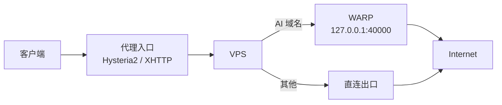

# WARP 出口

把指定流量（主要是 AI 服务）从 Cloudflare WARP 出去，与 VPS 原生 IP 解耦。

## 为什么需要

AI / SaaS 服务常受**地区可用性、机房 IP 信誉、出口变化**影响。让 AI 流量走 WARP，可以：

- 避免 VPS 机房 IP 被判定为风险账号
- 在 VPS 原生 IP 被服务拉黑时仍可用
- 不接管整台 VPS 的流量

**这解决的是「VPS 从哪里出去」，不是「怎么进入 VPS」。** 入口用 REALITY / XHTTP，出口用 WARP，两者独立。

---

## 架构



---

## 安装 WARP

```bash
curl -fsSL https://pkg.cloudflareclient.com/pubkey.gpg \
  | gpg --yes --dearmor -o /usr/share/keyrings/cloudflare-warp-archive-keyring.gpg

echo "deb [signed-by=/usr/share/keyrings/cloudflare-warp-archive-keyring.gpg] https://pkg.cloudflareclient.com/ $(lsb_release -cs) main" \
  | tee /etc/apt/sources.list.d/cloudflare-client.list

apt update && apt install -y cloudflare-warp
```

---

## 以代理模式运行

WARP 支持两种模式，**这里需要代理模式**（监听本地端口），而不是全局模式。

```bash
warp-cli registration new
warp-cli mode proxy
warp-cli proxy port 40000
warp-cli connect
```

验证：

```bash
curl -x socks5://127.0.0.1:40000 https://www.cloudflare.com/cdn-cgi/trace
# 输出应包含 warp=on
```

> 较新版本的 `warp-cli` 在代理模式下默认使用 **MASQUE** 协议。若某些子命令不被接受，以当前版本的 `warp-cli --help` 为准。

---

## 在 Xray 中作为出站

```jsonc
{
  "tag": "warp",
  "protocol": "socks",
  "settings": {
    "address": "127.0.0.1",
    "port": 40000
  }
}
```

路由规则：

```jsonc
{
  "type": "field",
  "inboundTag": ["xhttp", "reality", "hy2"],
  "domain": [
    "domain:openai.com",
    "domain:chatgpt.com",
    "domain:oaistatic.com",
    "domain:oaiusercontent.com",
    "domain:anthropic.com",
    "domain:claude.ai",
    "domain:gemini.google.com",
    "domain:aistudio.google.com",
    "domain:generativelanguage.googleapis.com"
  ],
  "outboundTag": "warp"
}
```

**注意**：除了 `direct` 与 `block`，其他出站都要显式加路由规则，否则不会生效。

---

## 在 mihomo 中作为出站

```yaml
proxies:
  - name: WARP
    type: socks5
    server: 127.0.0.1
    port: 40000
    udp: true

rules:
  - DOMAIN-SUFFIX,openai.com,WARP
  - DOMAIN-SUFFIX,claude.ai,WARP
  - DOMAIN-SUFFIX,anthropic.com,WARP
```

---

## 验证清单

- [ ] `warp-cli status` 显示 `Connected`
- [ ] `curl -x socks5://127.0.0.1:40000 https://www.cloudflare.com/cdn-cgi/trace` 输出 `warp=on`
- [ ] 访问 AI 服务时出口 IP 与 VPS 原生 IP 不同
- [ ] 非 AI 流量仍走直连（未被 WARP 接管）

---

## 常见问题

| 现象 | 原因 | 处理 |
|---|---|---|
| `warp-cli` 报命令不存在 | 版本差异 | 以 `warp-cli --help` 为准 |
| 连不上 40000 端口 | 未设代理模式 | `warp-cli mode proxy` |
| 出口 IP 没变 | 路由规则未生效 | 检查规则 `inboundTag` 是否匹配 |
| WARP 连接不稳定 | Cloudflare 侧波动 | 保留直连作为回退，不要全量走 WARP |

---

## 参考资料

- Cloudflare WARP — <https://developers.cloudflare.com/warp-client/>
- Cloudflare WARP Linux 客户端 — <https://pkg.cloudflareclient.com/>
